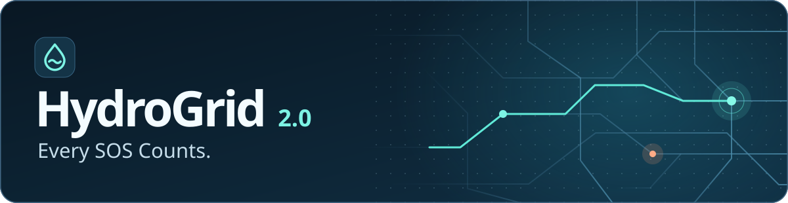
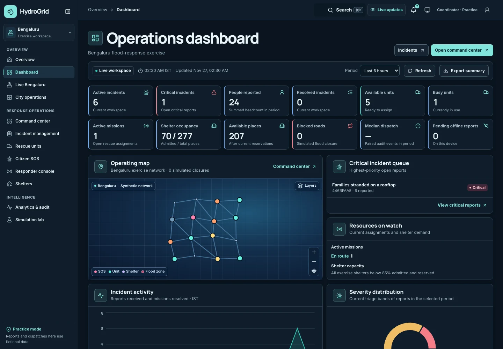
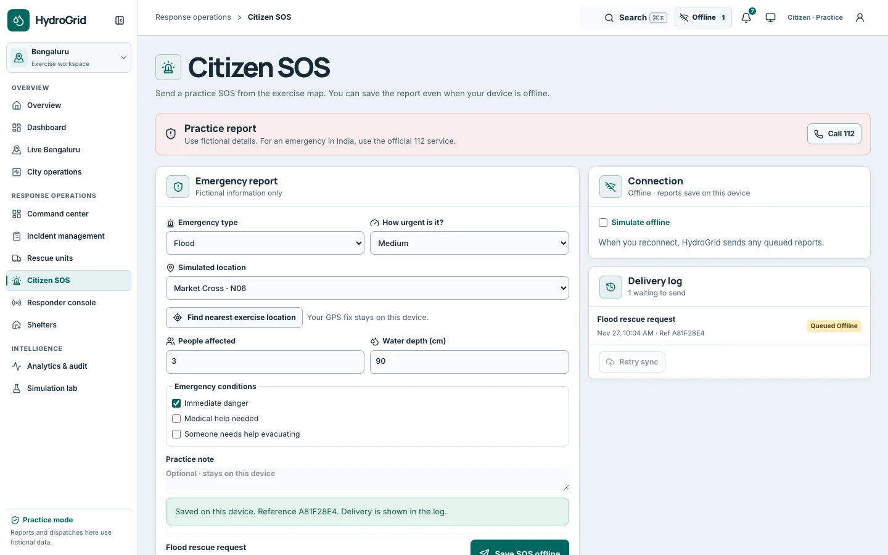
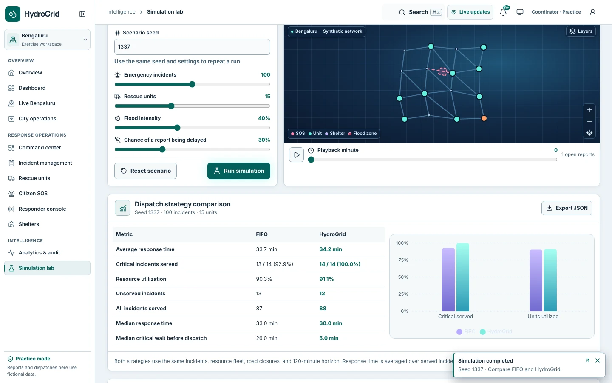
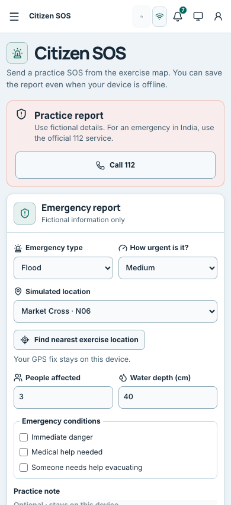
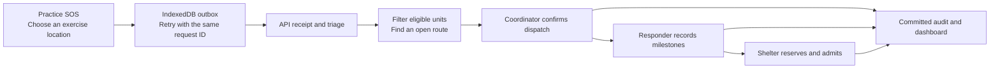
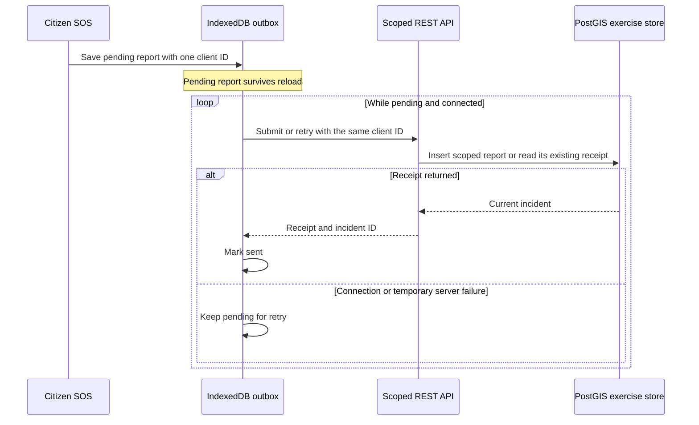
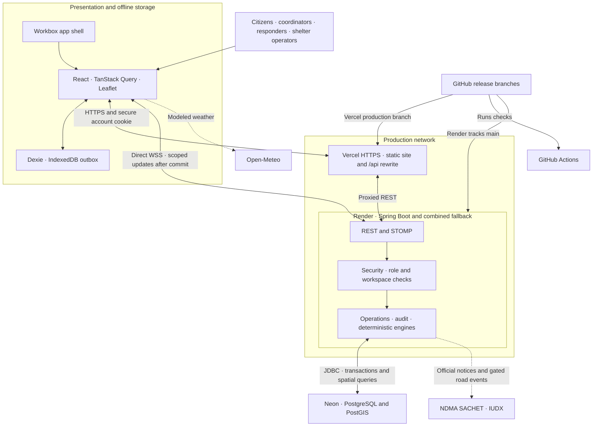
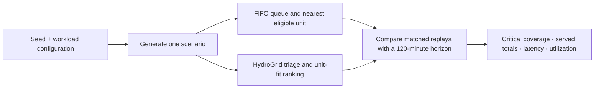
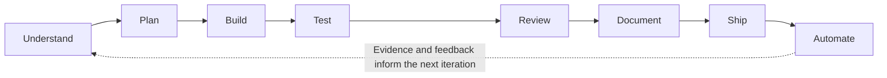

# HydroGrid — Real-Time Disaster Response and Rescue Coordination Platform

<table>
  <tr>
    <td></td>
    <td><strong>Created and built by <a href="https://github.com/Manu577228">Manu Bharadwaj</a></strong><br />Solo developer · Built with Codex</td>
  </tr>
</table>

## Product Demo & Video Showcase

### 1. Arcade — Guided Product Walkthrough

Explore HydroGrid's interface and discover how its disaster-response workflows fit together through a guided product demonstration.

https://github.com/user-attachments/assets/1e6c2099-6455-421f-bc94-253c6927e29b

[**View the Arcade walkthrough**](https://app.arcade.software/share/videos/MP7xitoNReNRFvuzHRsM)

### 2. YouTube — Project Presentation

Discover the motivation behind HydroGrid, its core capabilities, and its development for the Build with Codex challenge by GeeksforGeeks.

https://github.com/user-attachments/assets/4658d878-f527-4701-896a-7175c80d56d1

[**Watch the project presentation on YouTube**](https://youtu.be/IcKySsTgm60?si=2pmQiSN6Ya03ew2l)

---

**Every SOS Counts.** Practice the path from a citizen’s offline SOS to triage, dispatch, responder updates, and shelter admission. Then replay the same flood scenario under two dispatch policies and inspect the trade-offs.

[](https://github.com/Manu577228/HydroGrid/actions/workflows/ci.yml?query=branch%3Asubmission-final-audit)

[Live Vercel app](https://hydrogrid-response.vercel.app/) · [Render fallback](https://hydrogrid-demo-7v9f.onrender.com/) · [Backend health](https://hydrogrid-demo-7v9f.onrender.com/api/health) · [Judge walkthrough](docs/demo.md)

[Codex Evidence Pack](docs/evidence/CODEX_EVIDENCE_PACK.md) · [Architecture](docs/architecture/README.md) · [Latest CI](https://github.com/Manu577228/HydroGrid/actions/workflows/ci.yml?query=branch%3Asubmission-final-audit) · [Benchmark results](docs/benchmarks.md) · [Documentation index](docs/README.md)

HydroGrid is an accountable disaster-response prototype for citizens, coordinators, responders, and shelter operators. A practice report survives interrupted connectivity. A coordinator can inspect its priority, compare equipped units and open routes, then approve a dispatch. Responders and shelter operators record separate milestones, which the dashboard and audit history reflect after commit. **Rescue operations in the exercise are synthetic.** Live Bengaluru shows independently sourced geographic and environmental information. For an emergency in India, use the official 112 service. [Emergency Response Support System](https://112.gov.in/)

**On this page** · [Try the exercise](#experience-hydrogrid-in-90-seconds) · [See the product](#product-showcase) · [Follow its workflows](#disaster-response-intelligence-loop) · [Understand the system](#system-architecture) · [Compare policies](#scientific-benchmark) · [Run locally](#run-the-demo) · [Review the full lifecycle](#complete-software-development-lifecycle--built-with-codex)

## Experience HydroGrid in 90 Seconds

| Time after load | Try this | Look for |
| --- | --- | --- |
| 0:00–0:20 | Open the [live demo](https://hydrogrid-response.vercel.app/) and choose **Start interactive demo**. Open **Citizen SOS**, select a map location or landmark, and send a fictional report. | The isolated practice workspace opens without registration. The SOS gets a delivery receipt. |
| 0:20–0:55 | Open **Command center**, select the new report, and inspect its priority, unit recommendation, and route. Choose a compatible report or seeded incident if a recommendation is unavailable. Review and confirm dispatch, then open **Responder console**. | Coordinator approval creates an assignment. The responder can mark departure, arrival, and completion. |
| 0:55–1:30 | Open **Shelters** to see capacity, **Analytics & audit** to see committed events, and **Simulation lab** to compare the included dispatch policies. | Reservations and admissions have separate counts. Both policies replay the same scenario inputs. |

Free hosting may need about a minute to wake before the first step. The extended walkthrough covers a real browser outage, reconnect and deduplication, an exercise flood detour, and a linked shelter check-in. Use Docker if the hosted service is unavailable. [Verified judge walkthrough](docs/demo.md) · [Two-minute demo storyboard](docs/demo-script.md) · [Local quick start](#run-the-demo)

## Product showcase

| Operations dashboard | Command center |
| --- | --- |
|  |  |
| Time-window metrics and committed exercise activity. | Review priorities, route availability, and unit fit before dispatch. |

| Offline SOS | Dispatch simulation |
| --- | --- |
|  |  |
| IndexedDB preserves the practice report until delivery. | Inspect coverage, elapsed response, utilization, and unserved reports. |



[Full screenshot gallery, including light and dark themes](docs/showcase.md)

## Why this problem matters

A report can arrive late during a network outage. The team that receives it still has to assess urgency, find a vehicle with the right equipment and capacity, identify a viable route, and know whether a shelter can admit the group. Each role needs a shared view of the current state and a record of decisions. FEMA’s January 2011 incident-management guidance treats interoperable communications, resource coordination, and situational awareness as core capabilities. [FEMA Incident Management and Support Keystone](https://www.fema.gov/sites/default/files/2020-07/fema_incident_management_and_support_keystone-Jan2011.pdf)

| Publicly documented approach | What its own documentation emphasizes |
| --- | --- |
| Ushahidi | Configurable surveys and mapped submissions for crowd reporting and analysis. [Ushahidi surveys](https://docs.ushahidi.com/platform-user-manual/3.-configuring-your-deployment/3.3-surveys) |
| Sahana Eden | Humanitarian coordination across assets, requests and inventories, plus shelter check-in and check-out. [Sahana Eden archive](https://sahanafoundation.org/products/eden/) |
| HydroGrid | One repeatable flood exercise linking offline SOS, scored triage, hazard-aware dispatch, responder and shelter state, and a paired policy replay with an audit trail. [Engineering design](docs/engineering.md) · [Benchmark methodology](docs/benchmarks.md) |

The project contribution is the integration of those decisions into a small, reproducible exercise. The ranking rules, shortest-path algorithm, spatial queries, and transaction mechanisms are established techniques.

## Disaster response intelligence loop



A browser can use a manual practice location or, with permission, use GPS to suggest a nearby fictional site. The separate private field workspace can share a real device fix with authorized participants. Simulations generate independent scenario inputs. [Data and operator boundaries](docs/operations.md)

| Capability | Implementation and verification |
| --- | --- |
| Citizen, coordination, and responder | **Implemented and verified.** Offline SOS and mission outboxes, idempotent retries, routed recommendations, confirmation, and mission transition checks. [Browser tests](e2e/tests/browser.spec.mjs) · [API tests](e2e/tests/api.spec.mjs) |
| Shelter, dashboard, and audit | **Implemented and verified.** Transactional capacity and check-in, scoped dashboard and event feeds, incident detail and exports. [Backend integration](backend/src/test/java/com/hydrogrid/HydroGridIntegrationTest.java) · [Dashboard tests](e2e/tests/platform.spec.mjs) |
| Geospatial view and field test | **Implemented and verified within a bounded area.** Exercise routing excludes intersecting closures. Live Bengaluru uses a separate OSM extract, modeled weather, and sourced bulletins. Opt-in device sharing uses private field access. [Live and field tests](e2e/tests/live.spec.mjs) |
| Authentication and city operations | **Implemented and verified in isolated fixtures.** Citizen accounts, browser-owned demo roles, and separately configured agency roles. The authorized traffic feed provides sourced observations when available. [Security](docs/security.md) · [Scoped operations](docs/operations.md) |
| Policy evaluation | **Experimental.** Fixed-seed paired replay with timing and coverage distributions. [Measured study](docs/benchmarks.md) |
| Delivery | **Implemented and verified for the deployed revision.** Docker and Compose reproduce the service. GitHub Actions runs backend and release checks. Vercel serves the dedicated frontend. Render serves the API and the combined fallback with Neon PostgreSQL. [Deployment evidence](docs/deployment.md) |

### Offline SOS synchronization

The browser records the report and its identifier before sending. If connectivity fails before the receipt comes back, a later attempt uses the same identifier. The server can return the existing incident, and the browser records delivery once it receives that receipt.



[Offline and concurrency workflows](docs/workflows/README.md) · [Offline browser regression](e2e/tests/browser.spec.mjs) · [Data retention and session scope](docs/security.md)

### Disaster response coordination

- The coordinator inspects the incident’s severity, equipment requirements, route, and capacity before confirming an assignment. The backend rechecks eligibility under lock.
- The responder records departure, arrival and resolution. Each offline milestone keeps its client operation ID until the server replies.
- A shelter operator reserves space and records admission separately. The transaction moves reserved places into admitted places, so a check-in does not free the same places again.
- The dashboard and audit use committed state. A scoped STOMP event prompts the React query cache to refresh. Reconnection and polling recover missed updates.

[Dispatch, responder, shelter and real-time diagrams](docs/workflows/README.md) · [Transactional integration tests](backend/src/test/java/com/hydrogrid/HydroGridIntegrationTest.java)

## System architecture



- **Explainable ranking and routing.** Severity, incident factors, and waiting time produce a visible score. The engine filters by capacity, equipment, and reachability. PostGIS identifies exercise closures before the routing engine searches available roads.
- **Durable client retries.** IndexedDB outboxes keep synthetic SOS and mission actions on the device. The server reconciles client-generated IDs against scoped receipts.
- **Coordinated state changes.** Database locks and constraints protect assignments and shelter capacity. An after-commit event signals clients to refresh scoped state.

| Layer | Stack | Role |
| --- | --- | --- |
| Browser | React 19, TypeScript, Vite 7, Tailwind 4, Leaflet, Recharts, TanStack Query | Typed and responsive operational views |
| Offline and updates | Dexie, IndexedDB, Workbox, STOMP | Durable pending actions, cached shell, and event-driven refresh |
| Service and data | Java 21, Spring Boot, Spring Security, Spring Data JPA and JDBC, PostgreSQL 16, PostGIS, Flyway | Authorization, transactions, geographic queries, and repeatable migrations |
| Validation and release | Maven, Testcontainers, Playwright, Docker Compose, GitHub Actions, Vercel, Render, Neon | Reproducible tests and single-image delivery |

[Detailed C4 views](docs/architecture/README.md) · [ER and security views](docs/architecture/data-security.md) · [Deployment and CI architecture](docs/architecture/deployment.md) · [Operational sequences](docs/workflows/README.md) · [Stack and engineering trade-offs](docs/engineering.md)

## Scientific benchmark

### Simulation and policy comparison



Three workloads and three seeds gave **nine paired runs**, each with a 120-minute simulation horizon. The policies share the same incident stream, offline delays, hazards, units, and eligibility constraints.

| Pooled result across nine runs | FIFO | HydroGrid |
| --- | ---: | ---: |
| Critical reports reached by horizon | 92 / 141 | 135 / 141 |
| Reports reached / unserved | 670 / 260 | 659 / 271 |
| Median simulated response for reached reports | 24 min | 18 min |
| p95 simulated response for reached reports | 80 min | 86 min |

HydroGrid reached 43 more critical reports and 11 fewer reports overall. The mean and median fell, while the p95 increased. These are synthetic replay outcomes measured among reports reached by the cutoff. [All per-seed results, chart, and reproduction](docs/benchmarks.md) · [Machine-readable study](docs/data/dispatch-study.json)

## Security, privacy, and test evidence

Citizen accounts, exercise roles, and private field and agency access use separate authorization. The exercise has a browser-held ownership proof. Real GPS sharing is opt-in and restricted to the private field test. Local security and browser tests cover session revocation, isolation, cross-workspace events, offline replay, and competing writes. [Security review](docs/security.md) · [Independent findings](docs/evidence/REVIEW_FINDINGS.md)

The split release passed **25 backend tests**, **17 local browser/API checks**, and **15 hosted Vercel Playwright checks**. The final sanity rerun passed **14 public Playwright checks** after an initial SOS delivery timeout and three successful focused retries. Two private write workflows passed against isolated fixtures. The Vercel frontend also passed **120** automated accessibility and layout scans. [Verification details](docs/testing.md) · [GitHub Actions on the deployment branch](https://github.com/Manu577228/HydroGrid/actions/workflows/ci.yml?query=branch%3Asubmission-final-audit)

## Run the demo

```sh
git clone --branch submission-final-audit --single-branch https://github.com/Manu577228/HydroGrid.git
cd HydroGrid
docker compose up --build -d --wait
curl --fail http://127.0.0.1:8080/api/health
```

Open [localhost:8080](http://127.0.0.1:8080/). Use another loopback port with `HYDROGRID_PORT` and stop with `docker compose down`. Docker Compose brings up a local PostGIS database and Flyway applies migrations during startup. [Fresh setup, test commands, and troubleshooting](docs/setup.md)

| Interface | Example entry points |
| --- | --- |
| Public | `GET /api/health`, `GET /api/live/alerts` |
| Browser-owned practice | `POST /api/auth/demo`, `POST /api/incidents`, `GET /api/dashboard`, `POST /api/simulation` |
| Account and field | Scoped account, field, and operations endpoints with separate credentials |
| Realtime | `/ws` with an authorized STOMP connection and subscription |

[API reference and synthetic examples](docs/api.md) · [Vercel, Render, Neon, and rollback](docs/deployment.md) · [Direct backend health](https://hydrogrid-demo-7v9f.onrender.com/api/health) · [2.0 release notes](docs/release-2.0.md)

## Complete Software Development Lifecycle — Built with Codex



| Stage | What changed | Codex contribution | Verified outcome |
| --- | --- | --- | --- |
| [Understand](docs/evidence/lifecycle/01-understand.md) | Scoped the flood-response bottlenecks and public exercise boundaries. | Read the briefs, traced stakeholder needs, and checked the actual data sources. | A guest exercise, sourced Bengaluru view, and separately gated field access. |
| [Plan](docs/evidence/lifecycle/02-plan.md) | Defined the owned workspace, offline client, spatial service and shared release. | Mapped repository contracts, risks and acceptance checks. | Versioned API, schema, testing and deployment design with traceable decisions. |
| [Build](docs/evidence/lifecycle/03-build.md) | Implemented SOS, routing, dispatch, missions, shelters, analytics and replay. | Delegated independent frontend, backend and engine implementation. | Reviewable changes in source, five additive migrations, and working deployments. |
| [Test](docs/evidence/lifecycle/04-test.md) | Verified isolation, outage recovery, dispatch contention and browser flows. | Ran Maven, Testcontainers, Playwright and axe against the appropriate environments. | 25 Java tests and 17 local Playwright checks passed in the split-release verification. |
| [Review](docs/evidence/lifecycle/05-review.md) | Investigated races, authorization boundaries, accessibility and package advisories. | Reviewed source, read CI logs, and repeated named regressions. | Corrections and scope limits recorded with source, commits, and tests. |
| [Document](docs/evidence/lifecycle/06-document.md) | Built this guide, architecture views, workflow diagrams, and submission evidence. | Cross-checked diagrams and links against implementation and release evidence. | A judge can trace a product claim to its source and reproduction instructions. |
| [Ship](docs/evidence/lifecycle/07-ship.md) | Connected Vercel to the Render API and Neon-backed state, retaining the combined app. | Verified exact provider revisions, public health, WebSockets and auth. | The Vercel app, Render API and fallback are publicly reachable. |
| [Automate](docs/evidence/lifecycle/08-automate.md) | Connected pushes and PRs to verification and the approved branch to deployment. | Configured CI and verified migration, event and retry behavior. | Git-triggered Vercel deploy and successful backend and image-release jobs. |

## Built with Codex — Competition Evidence

**The 1-Month Build Challenge — Build with Codex.** The Evidence Pack records the request, engineering decisions, implementation, and verification for **Understand → Plan → Build → Test → Review → Document → Ship → Automate**. It distinguishes terminal and browser work, parallel Codex agents, repository instructions, Neon skills and MCP configuration, and external delivery services. Local session metadata shows `gpt-6.2-sol` with `ultra` for the recorded root turns and inherited subagent settings. It documents the absence of measured model switching or comparative reasoning runs. [Evidence Pack](docs/evidence/CODEX_EVIDENCE_PACK.md) · [Capability matrix](docs/evidence/CAPABILITY_MATRIX.md) · [Model decision log](docs/evidence/MODEL_DECISION_LOG.md)

| Judging criterion | Evidence |
| --- | --- |
| Lifecycle Coverage and Depth · 30 | [Eight stages and their artifacts](docs/evidence/CODEX_EVIDENCE_PACK.md) |
| Codex Capability Use and Fit · 25 | [Recorded usage and oversight](docs/evidence/CAPABILITY_MATRIX.md) · [Persistent AGENTS.md](AGENTS.md) |
| Model and Reasoning Discipline · 20 | [Verified settings and limitations](docs/evidence/MODEL_DECISION_LOG.md) |
| Working Result and Engineering Craft · 15 | [Test report](docs/testing.md) · [Release PR](https://github.com/Manu577228/HydroGrid/pull/1) · [Regression PR](https://github.com/Manu577228/HydroGrid/pull/2) · [Workflow](.github/workflows/ci.yml) |
| Problem Worth Solving and Originality · 10 | [Judge walkthrough](docs/demo.md) · [Paired dispatch study](docs/benchmarks.md) |

[Full traceability matrix](docs/evidence/TRACEABILITY_MATRIX.md) · [Submission branch history](https://github.com/Manu577228/HydroGrid/commits/submission-final-audit/) · [Submission checklist](docs/submission-checklist.md)

## Repository map

| Path | Contents |
| --- | --- |
| [frontend](frontend/) | React routes, maps, IndexedDB, application styling |
| [backend](backend/) | API, authorization, spatial engine, migrations and integration tests |
| [e2e](e2e/) and [deploy](deploy/) | Browser and API regression suites, benchmark runner and startup |
| [Documentation index](docs/README.md) and [Evidence Pack](docs/evidence/CODEX_EVIDENCE_PACK.md) | Engineering, setup, data sources, verification and judging evidence |

## Limitations and responsible use

- HydroGrid is a practice tool. Use official emergency services for actual incidents. Dispatch, flood depth, closure polygons, and the exercise shelter register are synthetic.
- The sourced map covers a bounded part of central Bengaluru. Modeled weather and published bulletins have independent update cadences. The authenticated traffic source can return no recent reports. Use the issuing authorities for live safety decisions.
- Citizen accounts lack email verification and password recovery. Private operator enrollment requires local administrator configuration. Free hosting can sleep. The benchmark and isolated load checks establish prototype behavior.
- Production extension would require authorized event feeds and operators, verified identity recovery and retention policies, and field validation with an agency. [Security and residual risks](docs/security.md) · [Data attribution and roadmap](docs/attribution.md)

## Copyright and credits

**© 2026 Manu Bharadwaj. All rights reserved** in the original HydroGrid project materials he owns. [Copyright notice](COPYRIGHT.md)

OpenStreetMap contributors supply the bounded street extract under ODbL. Open-Meteo, NDMA SACHET, and Bengaluru Traffic Police via IUDX retain their respective terms. The landing artwork is an illustration. [Source attribution and acknowledgments](docs/attribution.md)

[Live HydroGrid](https://hydrogrid-response.vercel.app/) · [Render fallback](https://hydrogrid-demo-7v9f.onrender.com/) · [Public repository](https://github.com/Manu577228/HydroGrid) · [Codex Evidence Pack](docs/evidence/CODEX_EVIDENCE_PACK.md) · [Final checklist](docs/submission-checklist.md)
