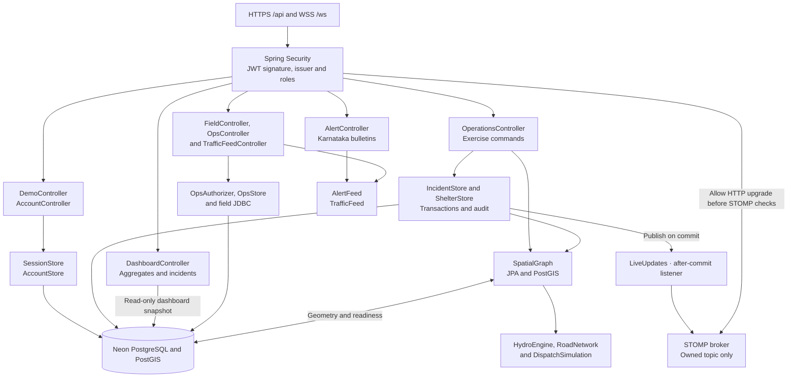

# Backend components

## Level 3 · Spring Boot application

The Spring Boot process owns REST, STOMP, request validation, transactions and provider access. The diagram distinguishes the request path from the event delivered after a commit. Controllers with direct reads use bound SQL, while action controllers delegate mutation logic to transactional stores.

| Responsibility | Implementation boundary |
| --- | --- |
| Access and identity | [Spring Security](../../backend/src/main/java/com/hydrogrid/config/SecurityConfiguration.java) gates the route families. [DemoController](../../backend/src/main/java/com/hydrogrid/api/DemoController.java) issues workspace-bound role tokens. [AccountController](../../backend/src/main/java/com/hydrogrid/api/AccountController.java) validates the browser origin, signs citizen access tokens and manages refresh and logout. |
| Exercise workflows | [OperationsController](../../backend/src/main/java/com/hydrogrid/api/OperationsController.java) checks method roles and delegates to [IncidentStore](../../backend/src/main/java/com/hydrogrid/store/IncidentStore.java), [ShelterStore](../../backend/src/main/java/com/hydrogrid/store/ShelterStore.java) or [SpatialGraph](../../backend/src/main/java/com/hydrogrid/store/SpatialGraph.java). Dispatch writes incident, unit state and audit in one transaction. Shelter writes lock the relevant capacity row. |
| Dashboard and audit | [DashboardController](../../backend/src/main/java/com/hydrogrid/api/DashboardController.java) reads a consistent dashboard snapshot using PostgreSQL repeatable read. Timeline and audit queries read scoped events with stored timestamps. |
| Private operations | [FieldController](../../backend/src/main/java/com/hydrogrid/api/FieldController.java) manages test device locations and reports. [OpsAuthorizer](../../backend/src/main/java/com/hydrogrid/api/OpsAuthorizer.java) and [OpsStore](../../backend/src/main/java/com/hydrogrid/api/OpsStore.java) enforce operator scopes and retain sourced observations and handoffs. |
| Provider access | [AlertFeed](../../backend/src/main/java/com/hydrogrid/api/AlertFeed.java) downloads the fixed NDMA SACHET Karnataka feed. [TrafficFeed](../../backend/src/main/java/com/hydrogrid/api/TrafficFeed.java) requests IUDX road observations with backend credentials when configured and viewed by the approved scope. |
| Real-time delivery | [LiveUpdates](../../backend/src/main/java/com/hydrogrid/config/LiveUpdates.java) publishes compact invalidation events after commit. [WebSocketConfiguration](../../backend/src/main/java/com/hydrogrid/config/WebSocketConfiguration.java) checks the exact Vercel origin for split connections, validates the workspace-owned bearer at STOMP `CONNECT`, and limits subscriptions to the owned topic and token lease. |

## Level 4 · Selected implementation views

| Function | Core behavior | Evidence |
| --- | --- | --- |
| `HydroEngine.triage` | Selects the higher reported or inferred band and adds bounded urgency contributions. A coordinator override includes a recorded reason. | [Engine](../../backend/src/main/java/com/hydrogrid/engine/HydroEngine.java) · [Triage and integration tests](../../backend/src/test/java/com/hydrogrid) |
| `SpatialGraph.snapshot` and `RoadNetwork.route` | Computes active flood zones and intersects their polygons with road geometry. Dijkstra skips the blocked IDs and uses travel-time weights. | [PostGIS adapter](../../backend/src/main/java/com/hydrogrid/store/SpatialGraph.java) · [Road network](../../backend/src/main/java/com/hydrogrid/engine/RoadNetwork.java) · [API coverage](../../e2e/tests/api.spec.mjs) |
| `IncidentStore.dispatch` | Locks the hazard snapshot and incident. Rechecks suitable units and conditionally reserves a unit. A conflict leaves the incident unchanged. | [Incident store](../../backend/src/main/java/com/hydrogrid/store/IncidentStore.java) · [Concurrent dispatch tests](../../backend/src/test/java/com/hydrogrid/HydroGridIntegrationTest.java) |
| `DispatchSimulation.run` | Replays HydroGrid and FIFO over the same seeded input and model horizon. Responses are computed for the request and policy outputs are compared together. | [Simulation engine](../../backend/src/main/java/com/hydrogrid/engine/DispatchSimulation.java) · [Benchmark methods and trade-offs](../benchmarks.md) |

The broker and rate-limit state are process-local. Scoped database state survives service restarts. Socket clients refresh REST state after a reconnect because the broker has no durable replay. [Concurrency and reconciliation details](../engineering.md) · [Release verification](../testing.md#dedicated-vercel-release-verification)
