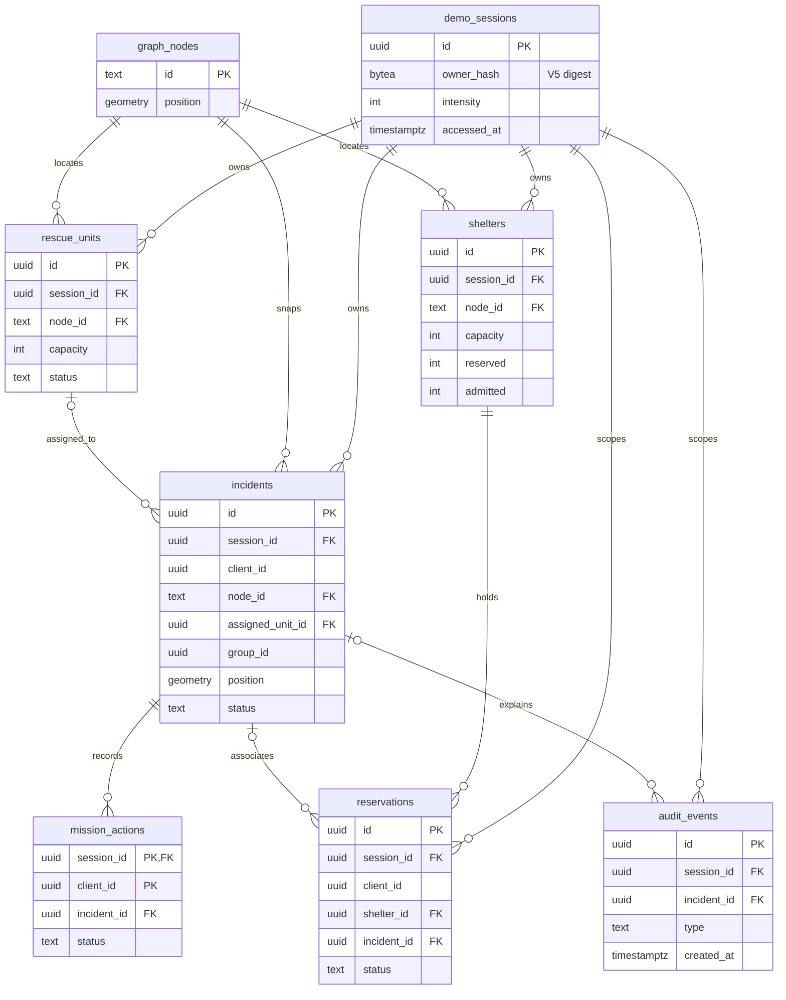
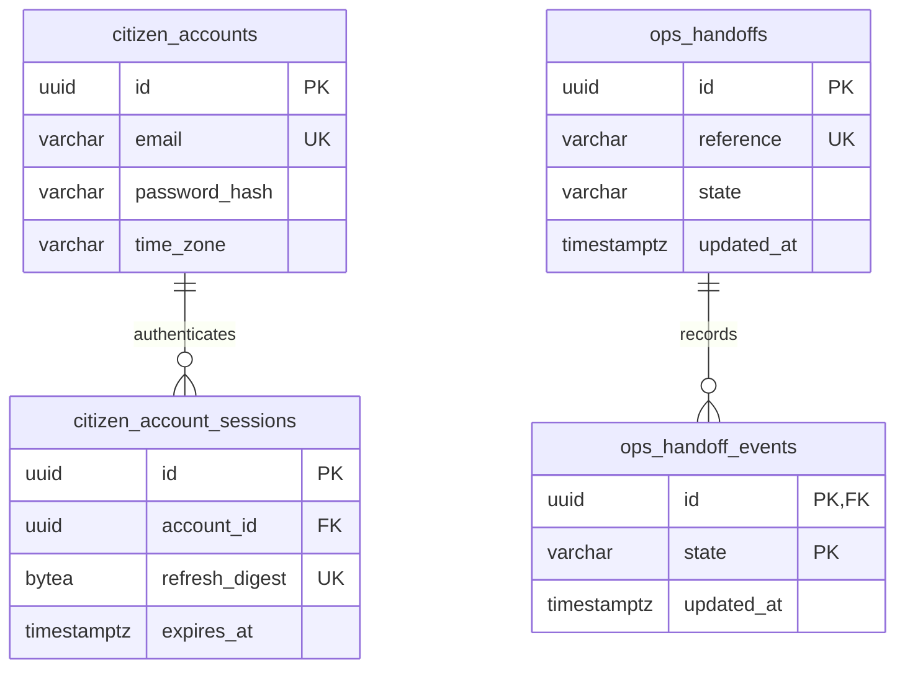
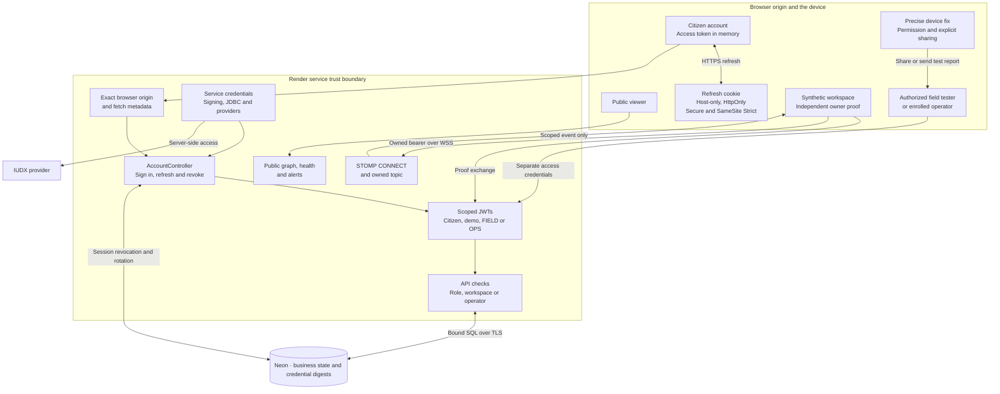

# Data and security architecture

## Exercise entity relationships

This logical ER diagram follows persisted exercise data at the Postgres boundary. Mermaid shows relationship cardinality. Composite and partial keys are described alongside the diagram because their column-level semantics protect workspace isolation.

Parent references from incidents to units, mission actions to incidents, reservations to shelters or incidents, and audit events to incidents use composite `(session_id, id)` relationships. `mission_actions.session_id` is part of the incident FK, and its PK is `(session_id, client_id)`. Nullable references allow unassigned incidents and reservations or audit entries that do not refer to an incident.

Incident creation and reservations deduplicate `(session_id, client_id)`. The partial unique index `incidents_active_unit_idx` prevents one unit from being assigned to multiple active incidents in one workspace. Dispatch takes an incident row lock and reserves the unit through a conditional update. Shelter capacity is protected by a row lock and the `reserved + admitted <= capacity` check. An admission changes the reservation status and shelter counters transactionally. The original reservation remains the record. [V1 schema](../../backend/src/main/resources/db/migration/V1__hydrogrid.sql) · [V5 owner binding](../../backend/src/main/resources/db/migration/V5__bind_demo_workspace_owner.sql) · [Concurrency verification](../../backend/src/test/java/com/hydrogrid/HydroGridIntegrationTest.java)

## Account and operator entity relationships

Citizen authentication and private operator handoffs have separate persistence from the exercise. The ER view shows the two additional FK families.

| Additional schema | Keys and implementation |
| --- | --- |
| `graph_roads`, `graph_flood_zones` | Both use a text primary key. Geometries use SRID 4326. GiST indexes road lines and the geography projection of incident positions. The startup seed persists geometry. `RoadNetwork` keeps node-edge topology in Java, and PostGIS returns blocked road IDs with `ST_Intersects`. [Graph persistence](../../backend/src/main/java/com/hydrogrid/store/SpatialGraph.java) · [V1](../../backend/src/main/resources/db/migration/V1__hydrogrid.sql) |
| `field_positions`, `field_reports` | Positions are keyed by device UUID. Reports use a distinct UUID PK and `(device_id, client_id)` uniqueness for retries. A report can persist after a device removes its current position. The schema has no FK between the two tables. [V2](../../backend/src/main/resources/db/migration/V2__private_field_workspace.sql) |
| `ops_observations`, `ops_observation_history` | The current observation uses PK `(kind, site_id)`. The history identity adds `observed_at`. Value and capacity constraints depend on whether the row represents flood, traffic, or shelter conditions. [V3](../../backend/src/main/resources/db/migration/V3__operator_workspace.sql) |
| Citizen sessions and simulation | `citizen_account_sessions.refresh_digest` is a unique 32-byte digest, rotated in place for an unexpired session. A simulation computes results for a request and returns replay data. There is no simulation table. [V4](../../backend/src/main/resources/db/migration/V4__citizen_accounts.sql) · [Simulation](../../backend/src/main/java/com/hydrogrid/engine/DispatchSimulation.java) |

Dashboard aggregates use read-only repeatable-read transactions. Workflow mutations use targeted locks and unique constraints. Exercise records cascade when a stale workspace is deleted. The separate cleanup jobs use explicit time windows for field reports, expired account sessions, operator history and closed handoffs. [Data retention schedules](deployment.md#operational-health-and-maintenance) · [Privacy details](../security.md)

## Trust boundaries

The trust-boundary view separates public reads, independent citizen sessions, synthetic exercise ownership and credentialed private paths. External provider credentials remain in the backend environment. The browser sends precise GPS to the test workspace only after device permission and the participant’s share or test-report action.

- **HTTP origin and CORS.** Vercel forwards the relative `/api` path over HTTPS. Browser account mutations require JSON, a matching origin on the combined deployment, or the configured HTTPS origin with explicit `Sec-Fetch-Site: same-origin` for the proxy alias. Direct cross-site account writes are rejected. The API uses first-party requests without a cross-origin cookie policy. [Origin allowlist](../../backend/src/main/java/com/hydrogrid/config/FrontendOrigin.java) · [Account checks](../../backend/src/main/java/com/hydrogrid/api/AccountController.java)
- **Scope.** Citizen and owned practice sessions use distinct credentials. Citizen authentication is separate from the role tokens issued under a verified synthetic workspace. Private field codes and enrolled OPS credentials grant their respective practice-test or city roles. OPS action scopes and traffic viewing are checked server-side. [REST roles](../../backend/src/main/java/com/hydrogrid/config/SecurityConfiguration.java) · [Operator authorization](../../backend/src/main/java/com/hydrogrid/api/OpsAuthorizer.java)
- **WebSocket origin.** The exact Vercel origin is allowed for the direct Render WSS connection. The combined site uses its own same-origin socket. STOMP requires an owned exercise bearer, blocks client writes and denies events outside the topic or past token expiry. [Socket configuration](../../backend/src/main/java/com/hydrogrid/config/WebSocketConfiguration.java)
- **Privacy.** The practice SOS can suggest a simulated location from a device fix. Its payload uses the selected exercise coordinates. In the private field test, a separate action explicitly sends the current fix. Shared positions and reports have visibility limits. [Practice SOS](../../frontend/src/pages/Sos.tsx) · [Private field controls](../../frontend/src/components/FieldPanel.tsx) · [Field retention](../../backend/src/main/java/com/hydrogrid/api/FieldController.java)

The deployed verification covered Vercel host-only cookie flags, direct cross-site denial, session restoration, logout and scoped WSS delivery. Citizen rate limits and the socket broker are process-local. The private field workspace is shared with other holders of its code. Citizen email verification and self-service recovery remain outside the prototype. [Verification record](../testing.md#dedicated-vercel-release-verification) · [Privacy and security review](../security.md)
