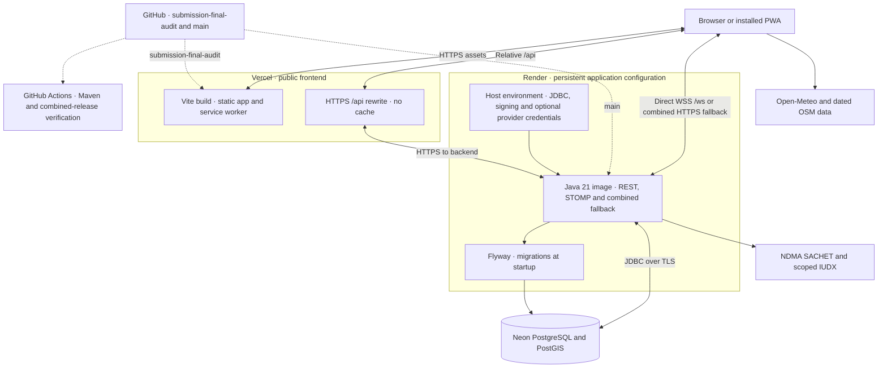
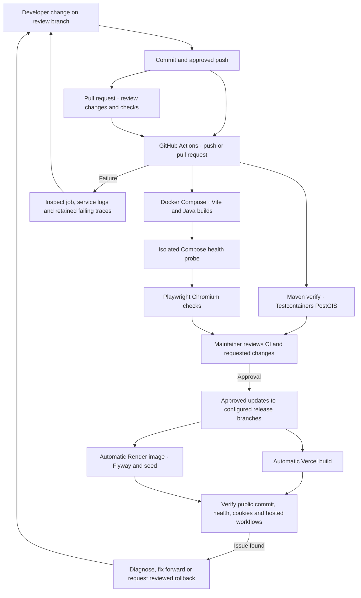
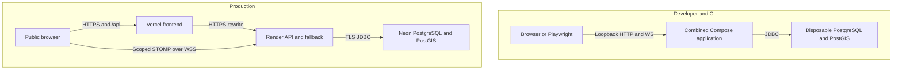
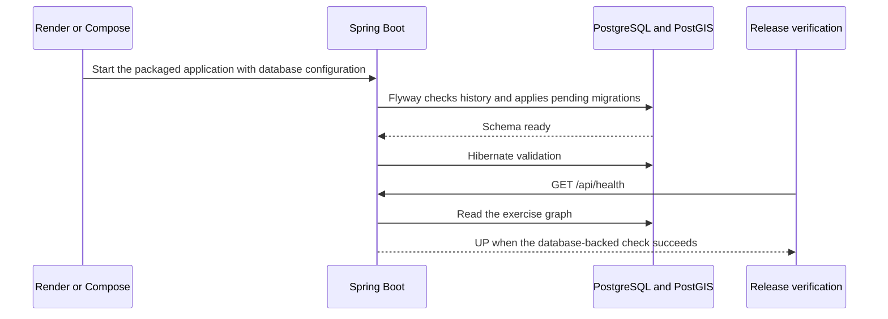
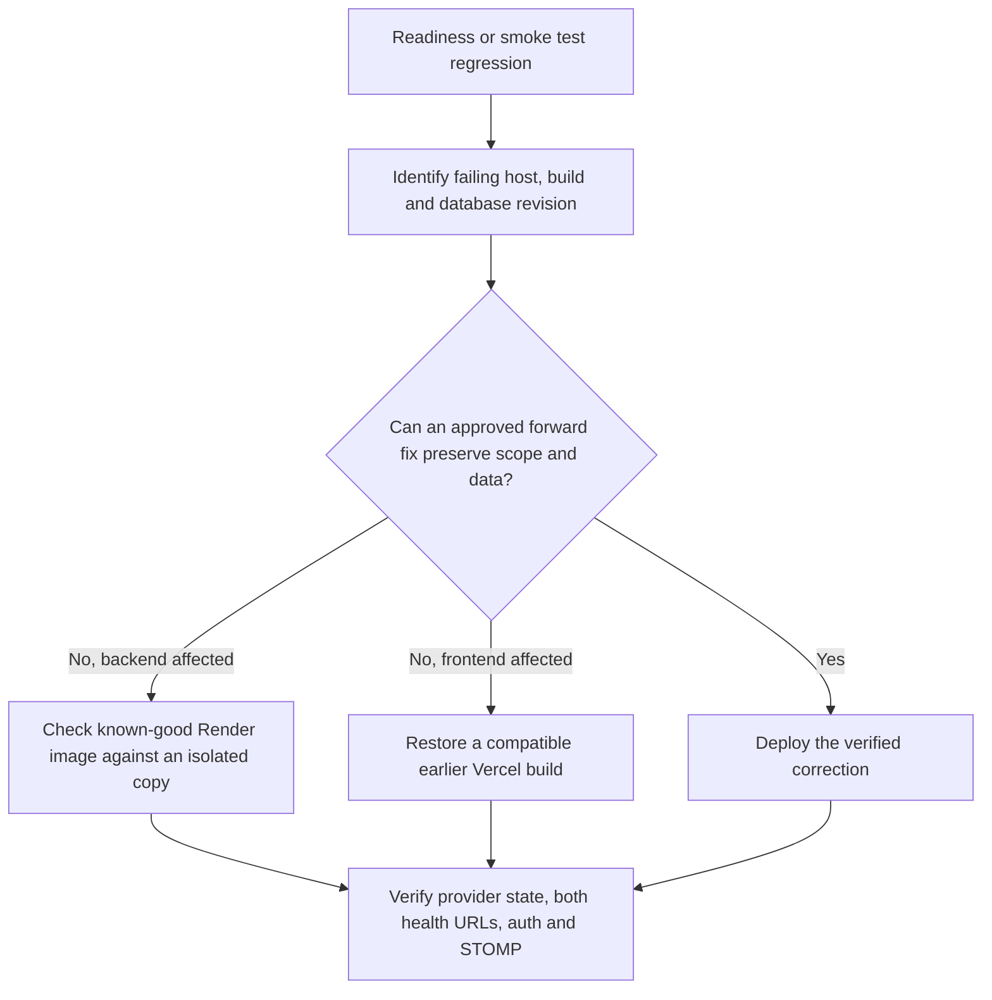

# Deployment and operations architecture

## Production infrastructure

The production view distinguishes the frontend and backend builds from request flow. Vercel tracks the approved submission branch. Render tracks `main` after the split application merge. The Spring Boot image includes the frontend as a working fallback and owns all PostgreSQL access.

The browser fetches the dated OSM extract from the deployed frontend assets. It calls Open-Meteo for modeled weather using fixed Bengaluru coordinates. The API serves public NDMA bulletins for Karnataka and provides the credentialed traffic feed to approved operators. Signing, database and optional provider credentials are injected on Render. The Vercel build exposes only public routing configuration such as its WSS endpoint. [Vercel routing](../../frontend/vercel.json) · [Render Blueprint](../../render.yaml) · [Dockerfile](../../Dockerfile) · [Privacy boundaries](data-security.md#trust-boundaries)

| Endpoint | Verification |
| --- | --- |
| [Vercel production frontend](https://hydrogrid-response.vercel.app/) | Deployment `dpl_r7TKbbHxwzL4M2YNC1sDPQHyXAW8` built integration revision `5d08129b5e08847322d509318c9fd637c7f0c883`. Hosted workflow and PWA tests verified this build. |
| [Vercel proxied health](https://hydrogrid-response.vercel.app/api/health) | API rewrite returned `UP` through Render and Neon. |
| [Render combined fallback](https://hydrogrid-demo-7v9f.onrender.com/) and [direct health](https://hydrogrid-demo-7v9f.onrender.com/api/health) | Integration deploy `dep-dc4kgl17lnhs738r3p1g` ran `5d08129`. Later docs-only revision `de1f0447718be73a71650f233a6430ff865339cb` was observed live as `dep-dc4kjarrjlhs73fuo0ng`; both health paths were still `UP`. The current main deploy `dep-dc4km5s9v7es73fbnuqg` serves merge `388edee` with the same tested application files. |
| Direct production socket | Hosted tests negotiated STOMP through `wss://hydrogrid-demo-7v9f.onrender.com/ws` and observed the scoped incident update. |

The deployment IDs and provider observations are dated November 27, 2026 IST. Provider branches can differ while both hosted surfaces use the same application files. Documentation updates advance the submission branch without changing the app tree. CI passed on the docs-only revision in both the push and pull-request paths. [Split rollout evidence](../deployment.md#verified-split-release) · [Application integration revision](https://github.com/Manu577228/HydroGrid/commit/5d08129b5e08847322d509318c9fd637c7f0c883) · [Docs-only revision](https://github.com/Manu577228/HydroGrid/commit/de1f0447718be73a71650f233a6430ff865339cb) · [Push CI](https://github.com/Manu577228/HydroGrid/actions/runs/45971879455) · [Pull-request CI](https://github.com/Manu577228/HydroGrid/actions/runs/45972012099)

## CI and release workflow

The pipeline separates automatic verification, provider builds and human approval. GitHub Actions runs on push and pull request. Each provider watches its configured branch. Publication approval applies to the branch being updated. The push-triggered build can start while its CI run is in progress.

The Docker release job builds the frontend and Spring Boot JAR through the same root Dockerfile that Render uses, then tests the combined image with local test fields and operator fixtures. A failure prints Compose service logs or retains Playwright traces as available, and teardown runs even on failure. Hosted split checks were separately executed during deployment verification. They are not a scheduled production checker. [Workflow](../../.github/workflows/ci.yml) · [Split-release successful run](https://github.com/Manu577228/HydroGrid/actions/runs/45970866151) · [Verification commands](../testing.md)

## Operational health and maintenance

| Capability | Existing behavior |
| --- | --- |
| Readiness and database | Render probes `/` as configured. Use direct or proxied `GET /api/health` to check the seeded graph query. The API returns HTTP 503 with `DOWN` when the graph is not ready or the database is unavailable. Flyway runs on startup and the application upserts its synthetic graph. [Readiness handler](../../backend/src/main/java/com/hydrogrid/api/DemoController.java) · [Graph seeding](../../backend/src/main/java/com/hydrogrid/store/SpatialGraph.java) |
| Failure evidence | Application logs record startup and provider failure classes. User-visible API errors, local queue state and GitHub Actions job output help isolate broken pathways. CI collects failing browser traces as available. [Problem configuration](../../backend/src/main/resources/application.yml) · [Bulletin logs](../../backend/src/main/java/com/hydrogrid/api/AlertFeed.java) · [CI artifacts](../../.github/workflows/ci.yml) |
| Exercise expiry | Cleanup runs every twelve hours and removes demo sessions that have not been accessed for 48 hours. Scoped exercise data cascades. [Workspace cleanup](../../backend/src/main/java/com/hydrogrid/store/SessionStore.java) |
| Private field cleanup | Positions are visible for at most five minutes without a refresh and test reports for 24 hours. Cleanup runs every 15 minutes. A device can explicitly remove its active position. [Field controller](../../backend/src/main/java/com/hydrogrid/api/FieldController.java) |
| Identity and operator housekeeping | Daily jobs remove expired citizen refresh sessions and prune operator history and closed handoffs older than 30 days. These application timers run while the server is running. [Account cleanup](../../backend/src/main/java/com/hydrogrid/api/AccountStore.java) · [Operations cleanup](../../backend/src/main/java/com/hydrogrid/api/OpsStore.java) |
| Reconnect and retry | STOMP reconnects with backoff and refreshes REST state. Visible exercise pages poll every 20 seconds when an online socket is unavailable. The IndexedDB outbox retries same-ID actions on startup, reconnect, its periodic trigger or an explicit retry. [Network state](../../frontend/src/network.tsx) · [Outbox](../../frontend/src/offline.ts) |
| Audit | Committed incident, assignment, mission and shelter actions persist exercise audit rows. Private city operations retain sourced observations and handoff events in their own tables. [Exercise audit](../../backend/src/main/java/com/hydrogrid/store/SessionStore.java) · [Operator audit](../../backend/src/main/java/com/hydrogrid/api/OpsStore.java) |

Monitoring consists of platform readiness checks, application and CI logs, and bounded hosted verification. Dedicated telemetry, external scheduled alerting and a production emergency SLA remain outside the documented prototype. Render cold starts can delay first access, and the combined fallback still depends on the same backend and database. [Run and recover](../deployment.md#recover-or-roll-back) · [Hosted test evidence](../testing.md#dedicated-vercel-release-verification)

## Environment topology

The same application code supports both environments. CI uses a disposable database and local-only role fixtures. Production keeps browser REST first-party through Vercel and opens the WebSocket directly to Render. The combined Render app still supports its own same-origin REST and socket.

[Compose definition](../../compose.yaml) · [Vercel routing](../../frontend/vercel.json) · [CI fixture and startup](../../.github/workflows/ci.yml)

## Migration and readiness workflow

A failed migration or schema mismatch prevents successful application startup. The platform root probe and the database-backed `/api/health` are separate checks. Local and hosted verification explicitly probe the latter. [Flyway migrations](../../backend/src/main/resources/db/migration) · [Application configuration](../../backend/src/main/resources/application.yml) · [Health implementation](../../backend/src/main/java/com/hydrogrid/api/DemoController.java)

## Recovery and rollback workflow

The recorded local rollback started an earlier combined image against the additive V5 schema. Database schema and records persist across an image rollback. That old image predates the workspace ownership change, so the observed startup result alone does not establish equivalent access protection. Restoring earlier frontend assets also requires testing compatibility with the live API. [Release recovery note](../deployment.md#recover-or-roll-back) · [Review findings](../evidence/REVIEW_FINDINGS.md)
