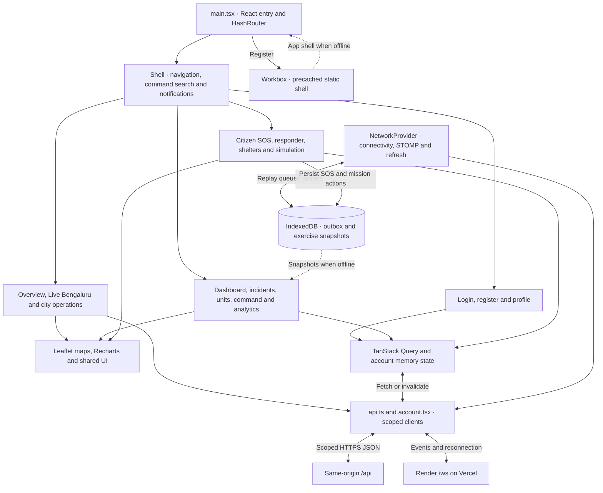

# Frontend components

## Level 3 · Browser application

The component view follows workflow pages into their shared data and connectivity layers. Workbox controls eligible static navigation requests and Dexie stores domain data under the current browser origin.

| Area | Source and behavior |
| --- | --- |
| Entry and navigation | [`main.tsx`](../../frontend/src/main.tsx) composes router, query, authentication and network providers. [Shell](../../frontend/src/components/Shell.tsx) owns desktop and mobile navigation, keyboard commands and notices. Hash routes keep page paths in the browser. |
| Operational views | [Dashboard](../../frontend/src/pages/Dashboard.tsx), [Incidents](../../frontend/src/pages/Incidents.tsx), [Resources](../../frontend/src/pages/Resources.tsx), [Command](../../frontend/src/pages/Command.tsx) and [Analytics](../../frontend/src/pages/Analytics.tsx) share scoped query data. [Leaflet map components](../../frontend/src/components/Map.tsx) and Recharts render geography and aggregates. |
| Exercise actions | [Citizen SOS](../../frontend/src/pages/Sos.tsx) and [Responder](../../frontend/src/pages/Responder.tsx) queue retry-safe operations. [Shelter](../../frontend/src/pages/Shelter.tsx) calls capacity and admission endpoints. [Simulation](../../frontend/src/pages/Simulation.tsx) requests a paired replay and presents the comparison. |
| Identity and external data | [Account views](../../frontend/src/pages/Account.tsx) use an in-memory access token and a host-only refresh cookie via [`account.tsx`](../../frontend/src/account.tsx). [Live](../../frontend/src/pages/Live.tsx) loads the [dated OSM graph](../../frontend/public/geography/README.md), [weather](../../frontend/src/liveWeather.ts) and public bulletins. [Operations](../../frontend/src/pages/Operations.tsx) and [FieldPanel](../../frontend/src/components/FieldPanel.tsx) use their own API access. |
| Connectivity and local state | [`api.ts`](../../frontend/src/api.ts) obtains exercise role tokens and invalidates queries after scoped updates. [`network.tsx`](../../frontend/src/network.tsx) tracks connectivity, starts the [outbox replay](../../frontend/src/offline.ts) and polls every 20 seconds on visible exercise pages when the socket is unavailable. [`snapshots.ts`](../../frontend/src/snapshots.ts) persists applicable exercise snapshots. |
| PWA cache | [Vite and Workbox configuration](../../frontend/vite.config.ts) precaches the built shell. The navigation fallback excludes `/api` and `/ws`. The Vercel API rewrite uses `private, no-store` and the account cookie remains scoped to `/api/account`. |

## Level 4 · Origin and storage separation

The Vercel and Render frontend URLs share the same API and Neon database. The browser isolates their refresh cookies, service workers, local storage and IndexedDB. Switching URLs can require a new sign-in and starts a separate local exercise unless the existing browser origin is used again. An offline queue on one origin remains on that origin. Keep the originating tab or URL available to finish synchronization.

The Vercel build points STOMP at Render through `VITE_HYDROGRID_WS_URL`. The Render build and Vite development use the page origin by default. HTTP requests remain relative `/api` on both hosted URLs. [Application configuration](../../frontend/src/api.ts) · [First-party rewrite](../../frontend/vercel.json) · [Production topology](deployment.md)

The Vercel release verification recorded 15 passing Playwright cases, two skipped private write fixtures and 120 sampled layout, axe and browser-error checks with no findings. The isolated combined release ran all 17 browser cases. [Verification record](../testing.md#dedicated-vercel-release-verification) · [Playwright suites](../../e2e/tests)
