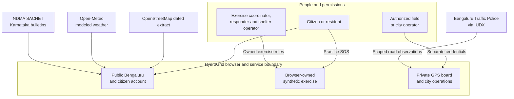
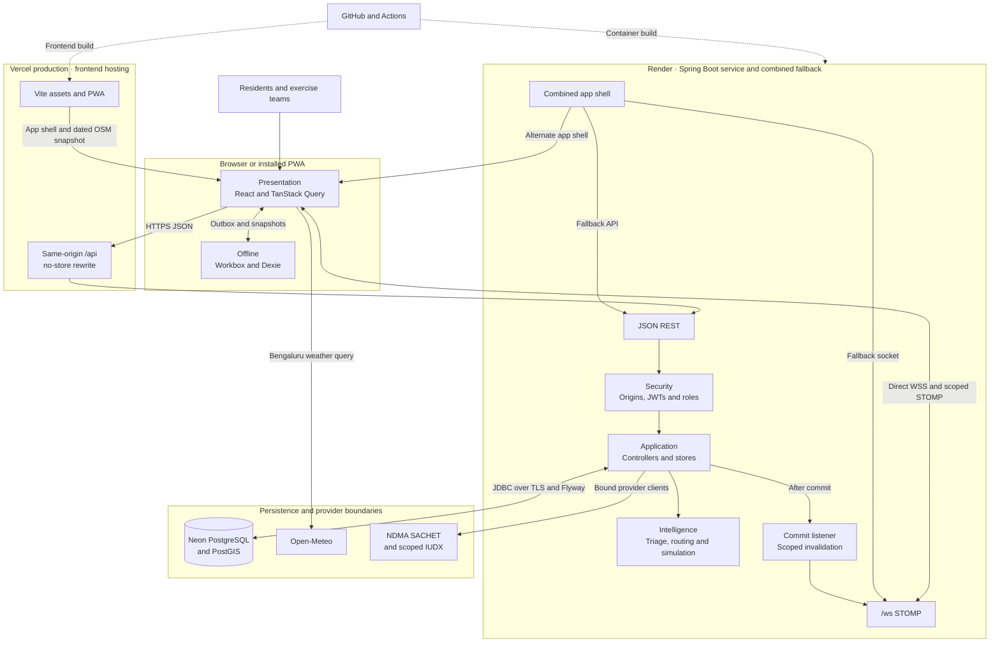

# System context and containers

## Level 1 · System context

The context view identifies who can enter each workspace and which providers supply sourced conditions. The practice users operate fictional records. Private operator and GPS test access require separate credentials.

Accounts manage a citizen profile. The exercise proof controls access to a synthetic workspace, with citizen, coordinator, responder and shelter tokens. Private field tests and city operations have separate access and retention policies. Latest sourced road observations are visible to authorized traffic viewers. The public Bengaluru graph still uses a dated OpenStreetMap extract. [Data provenance and attribution](../attribution.md) · [Provider and operator scope](../operations.md) · [Access and retention](data-security.md)

## Level 2 · Master system architecture

The container view follows a report from a browser through a database write and a committed live update. Arrows are labeled by transport or data. The dashed lines indicate the separately configured hosting and build connections.

| Boundary | Responsibility |
| --- | --- |
| Browser | Renders workflows. IndexedDB preserves pending reports and mission actions independently of the service worker’s precached shell. |
| Vercel | Builds and serves the static assets. It forwards browser API traffic under the frontend origin, preserving first-party cookie behavior. |
| Render | Verifies HTTP roles and socket subscriptions. Transactional stores write the authoritative state and publish exercise topics after commit. The same image serves its own React build as a fallback. |
| Neon | Stores scoped workflow data, account and session data, private test records and spatial data. Versioned Flyway migrations run from the Render application. |
| External data | The browser uses a dated geometry snapshot and Open-Meteo. The backend fetches NDMA bulletins and credentialed IUDX traffic separately from the exercise graph. |

The browser reconciles a committed STOMP signal with scoped REST data. It can also refresh over REST when the socket is interrupted. The separate frontend keeps account cookies first-party without exposing backend secrets in its build. [Frontend client](../../frontend/src/api.ts) · [Vercel rewrite](../../frontend/vercel.json) · [Render configuration](../../render.yaml) · [Backend event publisher](../../backend/src/main/java/com/hydrogrid/config/LiveUpdates.java)

Both production health paths returned `UP` on the split release. Hosted Playwright verified first-party authentication and an actual scoped event from Render. The fallback separately passed targeted mobile, dispatch and STOMP checks. [Verification and tested revisions](../testing.md#dedicated-vercel-release-verification) · [Deployment proof](../deployment.md#verified-split-release)
