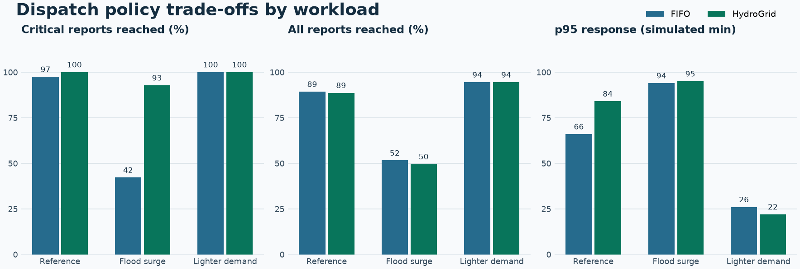

# Dispatch policy benchmark

HydroGrid reached **135 of 141 critical reports** across nine synthetic runs. FIFO reached **92 of 141**. HydroGrid reached **659 of 930 reports overall**, while FIFO reached **670 of 930**. The HydroGrid policy lowered the pooled median from 24 to 18 simulated minutes and raised the pooled p95 from 80 to 86 minutes. These trade-offs show why a judge should read coverage and response time together.



## Design

Each run generates one incident stream and fleet from its seed and replays both policies against the same release graph, flood closures, arrivals, offline delays, and feasibility constraints. FIFO prioritizes availability time, then reported time and ID, and prefers shorter open travel. HydroGrid recalculates triage score as incidents wait and ranks feasible units by travel time, spare capacity and equipment fit. Both use a 120-minute horizon, the same capacity and equipment requirements, and the same modeled service times. Results cover seeds **42, 1337 and 7** in each workload.

| Workload | Incidents | Units | Flood intensity | Network disruption |
| --- | ---: | ---: | ---: | ---: |
| Reference | 100 | 15 | 40% | 30% |
| Flood surge | 150 | 12 | 70% | 50% |
| Lighter demand | 60 | 18 | 20% | 10% |

The simulation generates severity from the report factors. The distribution is an outcome of the workload and seed. Shelter capacity belongs to the separate application workflow and does not participate in this dispatch replay. [Simulation implementation](../backend/src/main/java/com/hydrogrid/engine/DispatchSimulation.java) · [Paired trace exporter](../deploy/benchmark.mjs)

## All results

Each paired cell lists **FIFO → HydroGrid**. Time values are simulated minutes. This table includes every seed and workload evaluated.

| Workload | Seed | Critical reached | Reached | Unserved | Mean | Median | p95 | Fleet utilization |
| --- | ---: | --- | --- | --- | --- | --- | --- | --- |
| Reference | 42 | 10/10 → 10/10 | 88 → 89 | 12 → 11 | 32.03 → 29.27 | 34 → 25 | 62 → 84 | 88.94% → 85.72% |
| Reference | 1337 | 13/14 → 14/14 | 87 → 88 | 13 → 12 | 33.72 → 34.16 | 33 → 30 | 66 → 85 | 90.33% → 91.06% |
| Reference | 7 | 15/15 → 15/15 | 93 → 89 | 7 → 11 | 30.24 → 28.21 | 29 → 23 | 70 → 81 | 87.94% → 86.61% |
| Flood surge | 42 | 8/26 → 23/26 | 73 → 70 | 77 → 80 | 45.33 → 36.07 | 44 → 26.5 | 96 → 95 | 90.42% → 90.42% |
| Flood surge | 1337 | 15/33 → 30/33 | 76 → 75 | 74 → 75 | 46.38 → 39.75 | 45 → 29 | 94 → 99 | 97.08% → 97.15% |
| Flood surge | 7 | 12/24 → 24/24 | 83 → 78 | 67 → 72 | 43.73 → 35.68 | 44 → 29 | 89 → 92 | 96.32% → 96.32% |
| Lighter demand | 42 | 2/2 → 2/2 | 57 → 57 | 3 → 3 | 8.47 → 7.07 | 7 → 6 | 19 → 21 | 46.30% → 43.98% |
| Lighter demand | 1337 | 9/9 → 9/9 | 56 → 56 | 4 → 4 | 11.54 → 8.61 | 9 → 6 | 31 → 23 | 46.62% → 44.58% |
| Lighter demand | 7 | 8/8 → 8/8 | 57 → 57 | 3 → 3 | 6.63 → 6.04 | 5 → 5 | 19 → 18 | 43.80% → 43.29% |

| Pooled metric | FIFO | HydroGrid |
| --- | ---: | ---: |
| Critical reached | 92/141 (65.25%) | 135/141 (95.74%) |
| Reached and unserved | 670 and 260 | 659 and 271 |
| Mean simulated response | 30.65 min | 26.77 min |
| Median simulated response | 24 min | 18 min |
| p95 simulated response | 80 min | 86 min |
| Fleet utilization weighted by unit-minutes | 73.15% | 72.08% |
| Invalid assignments found by trace checks | 0 | 0 |

The most pronounced critical-coverage gains occur under flood surge. In those three runs HydroGrid reaches fewer reports overall. At reference seed 1337, it reaches one more critical report while mean response increases. At reference seed 7, it leaves four additional reports unserved. Its p95 is higher in six runs. Workload construction, small sample size, and censoring at the horizon prevent a general performance claim.

## Definitions and measurement

- **Reached** means the unit arrives by simulated minute 120. Unserved includes reports with no assignment and arrivals after the horizon. Critical reached uses the generated critical classification and the same cutoff.
- **Response time** is arrival minus incident creation. It includes modeled offline delay, waiting for an eligible unit, and travel. Mean, midpoint median, and nearest-rank p95 use reached reports. The pooled metrics recompute from the combined reached-report times.
- **Fleet utilization** is modeled occupied unit-minutes over total unit-minutes available in the horizon. Pooled utilization weights each run by its fleet size.
- **Invalid assignments** count replay records with a repeat incident, concurrent use of one unit, dispatch before the report is available, insufficient seats or equipment, an unreachable route, or a blocked road on the route. The trace check found zero instances for either policy in these runs.
- **Request wall time** includes HTTP and response transfer plus both replays and JSON processing. One sequential local sample per run ranged from 7.36 to 143.29 ms. The first request was the maximum and may include warm-up. The study does not isolate algorithm CPU time or estimate public service latency.

Measured Nov 27, 2026 IST on the fresh isolated Compose build based on deployed `940edb0`, with the same simulation code, local PostgreSQL 16.9 and PostGIS 3.5.2, Java 21 container runtime, and a Node 24 client on macOS arm64. The benchmark uses fictional incidents and attributes no real response improvement. [All raw inputs, results and durations](data/dispatch-study.json)

## Reproduce

Start the [local app](setup.md) on port 8080, then run these commands from the repository root. Use `HYDROGRID_BASE_URL` to point to a different local port.

```sh
node deploy/benchmark.mjs
node deploy/benchmark.mjs --study > dispatch-study.json
```

The default command prints the three reference comparisons. The study command runs all nine scenarios, saves the policy results and response samples, and records varying request wall times. The app’s **Simulation lab** can replay each individual scenario with the same inputs and export the result.
