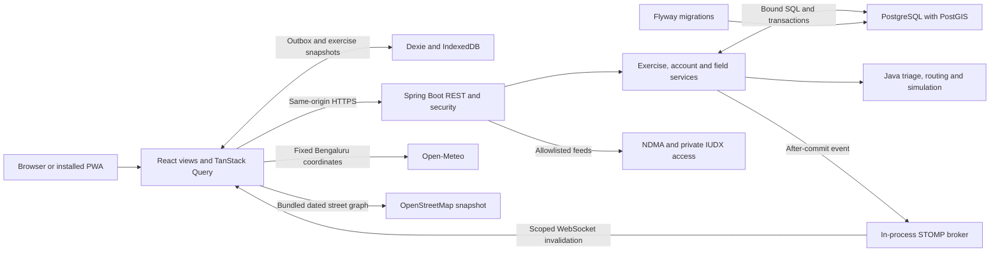
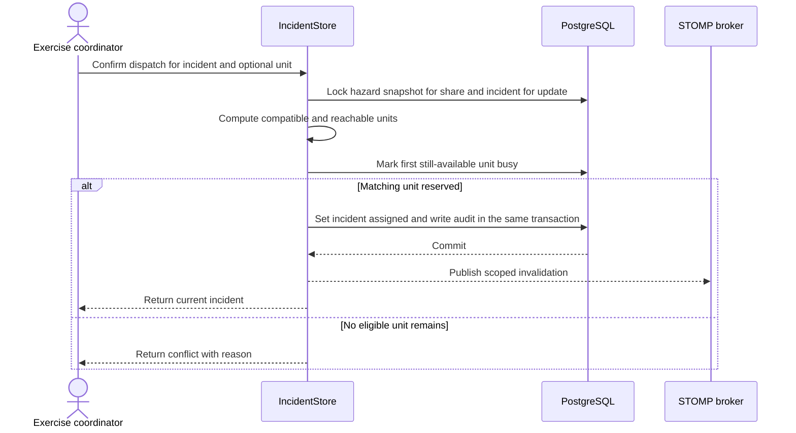
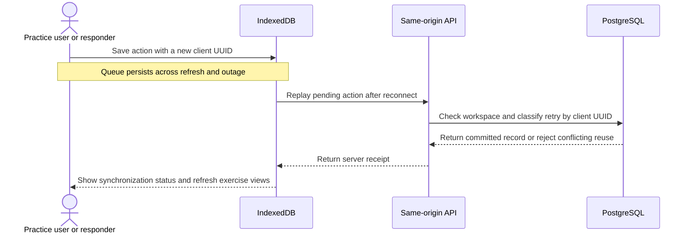

# HydroGrid architecture and engineering

HydroGrid runs as a single Spring Boot application behind one origin. The deployed JAR serves the React build, REST API and WebSocket endpoint. Java owns dispatch and consistency rules, PostgreSQL holds application state, and PostGIS evaluates spatial predicates. Public conditions and experimental rescue data enter through separate paths.

## Scope and storage

| Scope | Data and ingress |
| --- | --- |
| Public city information | The browser loads a dated, bounded OpenStreetMap street graph and asks Open-Meteo for metro-area model estimates at fixed coordinates. The server fetches the NDMA Karnataka bulletin feed and labels fallback snapshots. The street graph calculation uses directed edges and recorded turn restrictions. |
| Owned exercise | Browser-generated UUID plus a 256-bit proof creates a seeded exercise. The server stores a digest and requires the proof for any role token. Every practice action uses that exercise's incident, unit and shelter records. V1 creates the model and V5 adds ownership binding. |
| Citizen account | V4 creates an independent identity and revocable session store. Profile changes operate on the authenticated account. Practice exercise ownership remains browser-based. |
| Private field test | V2 stores explicitly shared GPS fixes and test SOS in a single access-code-gated workspace. Position and report visibility have time limits. |
| Private city operations | V3 persists scoped, sourced operator observations and manual handoff records. Approved traffic viewers read the server's IUDX road snapshot. Operator observations and current road event data remain separate from the public street routing graph. |

### Incident triage

[`HydroEngine.triage`](../backend/src/main/java/com/hydrogrid/engine/HydroEngine.java) picks the higher of the reported and inferred band. [`IncidentStore`](../backend/src/main/java/com/hydrogrid/store/IncidentStore.java) computes the current explanation from persisted inputs and elapsed time. Immediate danger or depth of at least 100 cm infers critical. Medical urgency, depth of at least 55 cm or eight people infers high. Vulnerability, depth of at least 20 cm or four people infers medium. An omitted reported band starts low and inference still applies. Input depth and flags come from the exercise report. The score starts at 100 points per band, then adds bounded contributions for headcount, medical urgency, vulnerability, depth and elapsed wait. A coordinator can set an explicit band with an audited reason. These are deterministic exercise rules with unverified self-reported inputs.

### Matching and routing

The matcher checks availability, equipment, capacity and route reachability. Medical cases require medical equipment. Floods require high clearance or a boat, and reported depth of at least 55 cm requires a boat. Ranking minimizes travel minutes plus 0.35 per spare place and small penalties for consuming unnecessary specialist equipment. Travel time then unit ID resolves ties. A capacity shortfall asks an operator to plan additional trips or units.

[`SpatialGraph`](../backend/src/main/java/com/hydrogrid/store/SpatialGraph.java) seeds the exercise geometry, snaps coordinates by nearest geography, and obtains blocked road IDs with `ST_Intersects` between road lines and active flood polygons. [`RoadNetwork`](../backend/src/main/java/com/hydrogrid/engine/RoadNetwork.java) runs Dijkstra on the graph weighted by estimated travel time. It excludes blocked edges and reports unreachable with empty paths when the endpoints are disconnected. The simulation uses the same road and flood definitions and Java segment–polygon intersection. Neither engine incorporates live flood depths or Agency/IUDX closures. The public Bengaluru view has a separate, road-distance-based graph in [`geography.ts`](../frontend/src/geography.ts). This routing capability is an explanation of exercise decisions and source data, with no real-world clearance guarantee.

For a mission update, the incident lock and the workspace-scoped action ID serialize and deduplicate a strictly ordered state machine. Resolution releases that unit at the incident node. Initial dispatch owns the `REPORTED → ASSIGNED` transition, followed by `EN_ROUTE → ON_SCENE → RESOLVED`. Shelter changes lock the shelter row, validate available capacity and write a reservation or admission plus an audit row in one transaction. Admission transfers reserved counts to admitted. Repeated admission returns the current receipt. The database constrains `reserved + admitted` to capacity. [`ShelterStore`](../backend/src/main/java/com/hydrogrid/store/ShelterStore.java) and [V1 schema](../backend/src/main/resources/db/migration/V1__hydrogrid.sql).

Grouping uses proximity, time and hazard to identify candidate reports. The operator confirms a group and each report keeps its own ID and headcount. Dashboard reads use PostgreSQL repeatable-read isolation and Bengaluru time bins. Response duration derives from paired committed report, dispatch, arrival or resolution timestamps. The incident register uses a seven-day filter, sorts scoped results and returns 20 rows per page. Its current implementation reads the workspace's incident rows before filtering and pagination. [`DashboardController`](../backend/src/main/java/com/hydrogrid/api/DashboardController.java).

### Offline and real-time reconciliation

Workbox precaches the shell. Dexie stores practice reports, mission actions and snapshots. Startup, a five-second interval, connectivity changes and explicit retry trigger replay in creation order. Network failures, authorization expiry, throttling and server errors leave actions pending. Other rejected actions show a replay failure with an explicit retry. A matching API receipt marks the local action sent. Report notes stay in IndexedDB. Older unowned exercises open a fresh workspace and retain earlier local copies for inspection. An earlier pending report can be explicitly resent, while a mission belongs to its original exercise. [Outbox implementation](../frontend/src/offline.ts) · [Snapshot persistence](../frontend/src/snapshots.ts).

The STOMP client connects to `/ws` and subscribes to the exact topic for its owned exercise. The server rejects other topics and client publishing, and checks lease expiry. An after-commit publisher emits entity invalidations, and the browser re-reads REST state rather than assuming an event was delivered exactly once. The client deduplicates a rolling set of 100 message IDs, renews the connection, reconnects with backoff, refreshes on connect and polls every 20 seconds while a visible exercise page has no live socket. The in-process broker suits a single instance with REST reconciliation. Distributed event delivery and replay would require a persistent, shared mechanism. [Server broker](../backend/src/main/java/com/hydrogrid/config/WebSocketConfiguration.java) · [Commit listener](../backend/src/main/java/com/hydrogrid/config/LiveUpdates.java) · [Client connection](../frontend/src/api.ts) · [Polling fallback](../frontend/src/network.tsx).

### Simulation

[`DispatchSimulation`](../backend/src/main/java/com/hydrogrid/engine/DispatchSimulation.java) generates one seeded workload, fleet, closure set and disruption schedule, then replays both dispatch policies for a 120-minute model horizon. FIFO chooses the earliest available report and the fastest eligible unit. HydroGrid orders by deterministic priority and ranks eligible units using route, capacity and equipment. The served-report mean must be read alongside critical service rate and unserved counts. [Reproduction and mixed benchmark results](benchmarks.md).

## Stack and design rationale

Versions below are declared or resolved by the source and container manifests. Rationale describes fit and trade-offs visible in the implementation. The project does not record a formal evaluation of alternative frameworks.

| Technology | Role and fit | Trade-off |
| --- | --- | --- |
| React 19.2.4, TypeScript 5.9.3, Vite 7.3.8 | Typed workflow views and lazy-loaded pages. Vite builds static assets and proxies same-origin REST and STOMP during development. | Statically typed client models still depend on API contract checks. |
| Tailwind 4.1.18, Lucide 0.562.0, Recharts 3.7.0, Leaflet 1.9.4 | Responsive utility and CSS styling, consistent icons, analytical charts and interactive maps. | Map and chart rendering add visual and keyboard complexity. |
| TanStack Query 5.90.12, Dexie 4.2.1, Workbox via vite-plugin-pwa 1.2.0 | Coordinate query invalidation, durable browser outbox and cached shell. | Local storage can be cleared, and external feed data requires connectivity. |
| Java 21, Spring Boot 3.5.16, Spring Security, Spring Data JPA, Jackson 2.21.7 BOM and PostgreSQL JDBC 42.7.12 | Serve one origin and enforce access, validation and transactional workflows. JDBC handles bound SQL and PostGIS joins. JPA maps graph nodes for native nearest-node queries. | The single deployment couples API and UI release cadence and uses a shared process for sockets. |
| STOMP JavaScript 7.2.0 and Spring WebSocket | Deliver scoped after-commit signals with a small subscription surface. | A disconnected consumer reconciles with REST. The broker has no durable event replay. |
| PostgreSQL 16, PostGIS 3.5 in Compose, Flyway | Store consistent operational state, constrained capacity and geometric predicates. Apply versioned migrations during startup. | The local PostGIS image targets Linux amd64 and may need emulation on ARM. |
| Node 24, Maven 3.9 container, Docker, Compose, Playwright 1.58.2 and GitHub Actions | Pin builds and automate integration and browser verification using the release image. | Toolchain downloads and container availability affect first-run time. |
| Render, Neon PostgreSQL | One public Docker instance and a separate managed database with TLS. | Free web service cold starts can delay the first visit. |

[Security boundaries](security.md) · [REST and WebSocket API](api.md) · [Reproduction](setup.md) · [Deployment](deployment.md)
