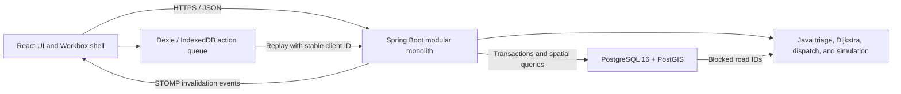

# HydroGrid engineering notes

## System shape

- **Routing.** The node graph is bounded and seeded. Live exercise routes exclude segments intersecting active polygon geometry via PostGIS. Java runs Dijkstra with a priority queue. The simulator uses the same road and flood definitions and a Java segment-polygon intersection check.
- **Triage.** Severity bands precede scoring within the band. Inputs cover danger, medical urgency, depth, vulnerability, headcount, and wait time. Coordinators can override the band with an audited reason.
- **Dispatch.** Candidate filtering checks availability, hazard equipment, capacity, and network reachability. Database transactions protect concurrent assignments. A capacity shortfall is surfaced for manual coordination.
- **Shelters.** Reservations and admissions share the same capacity ledger. Capacity allocation is transactional.
- **Grouping.** Candidate reports are matched by distance, time, and hazard. The coordinator confirms the relationship. The reports retain their own IDs and headcounts.
- **Offline.** The service worker precaches the app shell. Dexie stores SOS and mission actions with their client IDs. Reconnect, page startup, and retry intervals replay queued actions. Live events invalidate relevant browser queries.
- **Isolation.** Public users can enter demo roles in a synthetic workspace. JWT claims bind the role and workspace. STOMP subscriptions are scoped to the same workspace. The public exercise uses predefined report text and snaps report locations to synthetic graph nodes.

## Benchmark method

Both policies see the same seeded arrivals, available report times, equipment, road closures, workload, and 120-minute horizon. The FIFO comparator checks incidents in report availability order and selects the eligible unit with the shortest estimated travel time. HydroGrid sorts the available reports by deterministic severity and priority and ranks eligible units by travel time, capacity fit, and preservation of specialist equipment.

Response time is measured from the report's creation to simulated arrival. The denominator includes served reports only. Inspect this metric with unserved counts and critical service rate. Utilization is the share of fleet time occupied within the replay horizon.

Send the same input to the simulation endpoint twice to reproduce the generated incidents, units, replay events and metrics. The seeded experiment measures behavior under the model's assumptions. Changing the seed or workload can change which strategy performs better on individual metrics.

## Development lifecycle

The evidence index links each of the eight stages to decisions, code, tests, or measured results. Codex used `gpt-6.2-sol` at `ultra` reasoning effort according to the session configuration, and subagents inherited those settings. [Judging evidence](judging.md)
