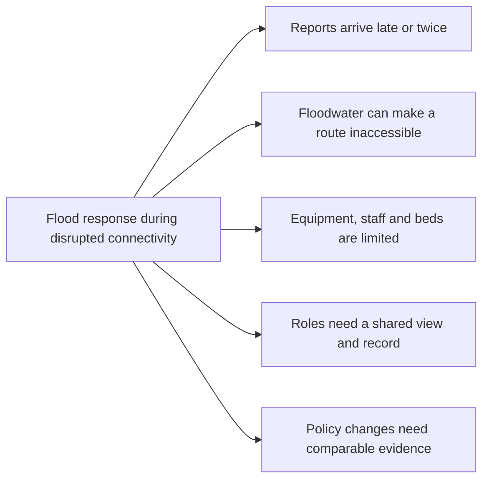
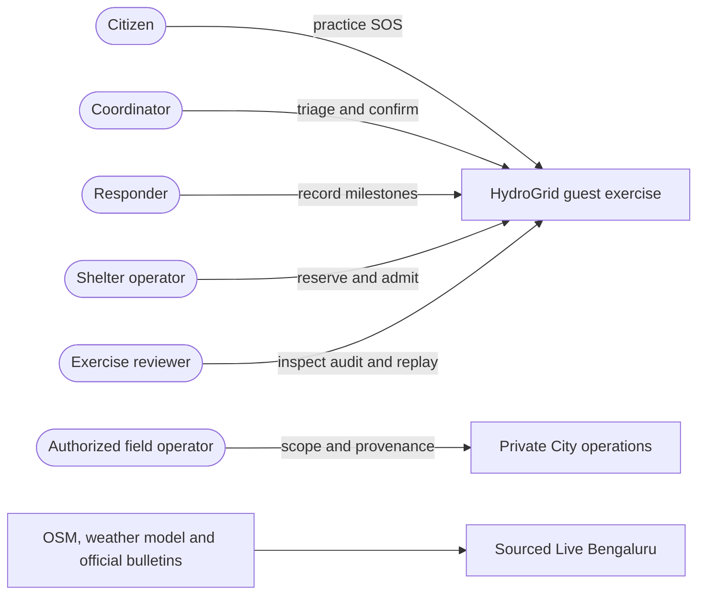
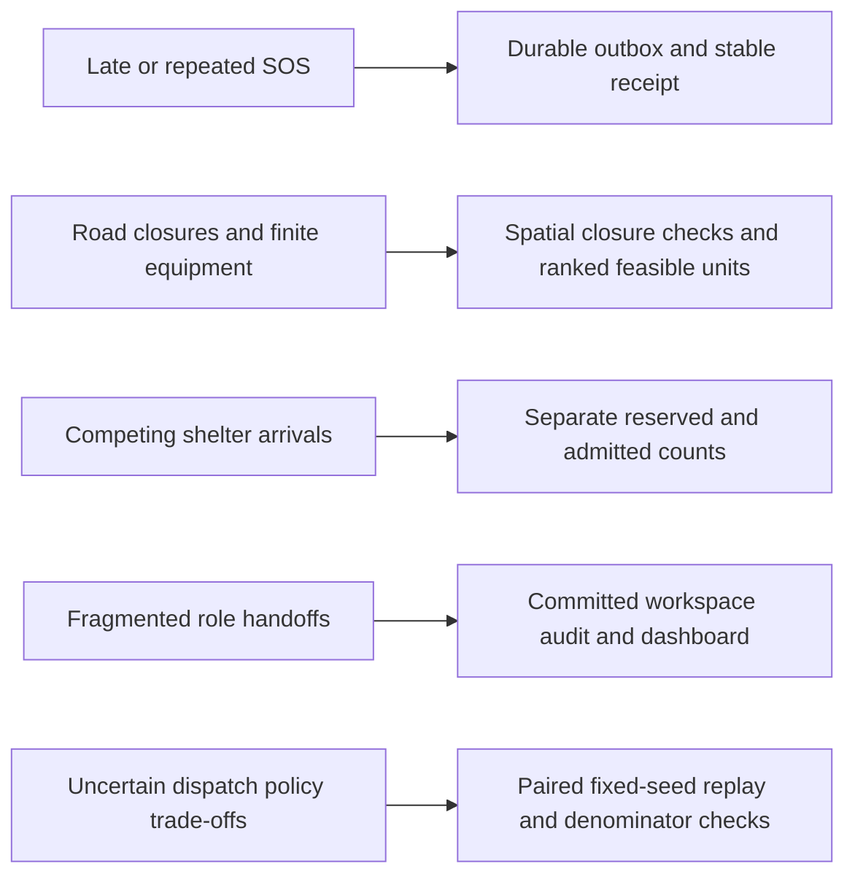

# Understand

**Status** · Complete for the competition prototype. Participant eligibility, interviews, usability in a real disaster, and agency validation are outside the recorded evidence.

The participant asked for a working end-to-end project and later asked what was genuinely live. The original build request and later source-scope request established two jobs: make the response exercise usable through an outage, and show sourced Bengaluru conditions with their own coverage and timestamps. A message queued in a browser, a sourced road, and an authorized emergency dispatch have different meanings. The product assigns each its own permission and status. [Recorded prompts P1 and P4](../CODEX_EVIDENCE_PACK.md#recorded-prompt-excerpts) · [Persistent instructions](../../../AGENTS.md)

## Problem decomposition

| Stakeholder | Need captured in the project scope | Product boundary |
| --- | --- | --- |
| Citizen | Save an SOS and tell pending delivery from acknowledgement. | Guest practice uses fictional details. The account and private field views are separate. |
| Coordinator | Judge urgency, find an equipped unit and approve dispatch over an open route. | Priorities, resources, hazards and travel in the exercise are modeled. |
| Responder | See the selected mission and record departure, arrival and completion with unreliable connectivity. | Previously saved mission state supports a limited offline workflow. |
| Shelter operator | Distinguish reserved places from admitted people. | Shelter capacity in the guest exercise is synthetic. |
| Authorized field operator | Limit observations and handoffs to the enrolled operator scope and retain source provenance. | The board requires separately authorized access. A report is never submitted to public emergency services. |
| Exercise reviewer | Repeat a policy comparison and inspect the same incident’s handoffs. | Seeded benchmarking measures simulated outcomes within its horizon. |

## Stakeholder interaction and system context

## Requirements and success criteria

| Need | Implemented direction | Acceptance evidence |
| --- | --- | --- |
| Delayed reports and unstable internet | A service-worker shell and durable action outbox with server acknowledgements. | Queue through a genuine Chromium disconnection and deliver once after reload and reconnect. [Browser tests](../../../e2e/tests/browser.spec.mjs) |
| Blocked roads, finite equipment and shelter space | Explainable triage, open-edge routing, unit feasibility, explicit approval and separate capacity states. | Prove flood rerouting, no double assignment and no capacity oversubscription under tested races. [PostGIS tests](../../../backend/src/test/java/com/hydrogrid/HydroGridIntegrationTest.java) |
| Fragmented role handoffs and no reproducible comparison | Read committed events across exercise pages. Replay the same workload with FIFO and urgency-aware dispatch. | Observe a linked workflow and audit history and independently rerun the study, including unfavorable results. [Judge walkthrough](../../demo.md) · [Dispatch study](../../benchmarks.md) |
| Real-world context and privacy | Bound geography and license sources, gate GPS and operator records, and avoid transmitting actual GPS from practice mode. | Inspect coverage and issue timestamps. Use local fixtures for private write checks. [Attribution](../../attribution.md) · [Privacy boundaries](../../security.md) |

The real-world map scope is a central Bengaluru street extract and seven landmarks. Karnataka bulletins cover a wider area. Live flood depths, emergency dispatch and verified shelter occupancy require agency sources and operators. In India, use the official 112 service for emergencies. [Public source scope](../../operations.md) · [Ministry of Home Affairs 112 service](https://www.mha.gov.in/emergency-response-support-system-erss)

## Engineering record

Codex inspected the original brief, decomposed the roles and constraints, and checked the existing implementation against the later request for sourced data. The participant chose the problem, steered the scope toward live context, and required protected tests. The audit maps stakeholder needs from those requests and from the committed product. It records no user research interview or field trial. The main corrective scope decision was to add the sourced view and private modules alongside the synthetic exercise so their signals cannot be confused.

The original scaffold and later scoped source commits are the durable outputs. Browser and source checks establish the prototype outcomes. [Scaffold](https://github.com/Manu577228/HydroGrid/commit/8214ee577bec0b8b5e1c247532d055749d398d08) · [Sourced Bengaluru and private GPS](https://github.com/Manu577228/HydroGrid/commit/9fc76a0f84045d2ec656ac3801b9384fc2de96c3) · [Scoped agency operations](https://github.com/Manu577228/HydroGrid/commit/920716d1c524f55fd8e5af2d416bb48a7152e2af)

**Recorded Codex configuration** · `gpt-6.2-sol` / `ultra`. The decision log distinguishes observed settings from retrospective task-fit explanation. [Model record D1 and D3](../MODEL_DECISION_LOG.md) · [Plan](02-plan.md)
