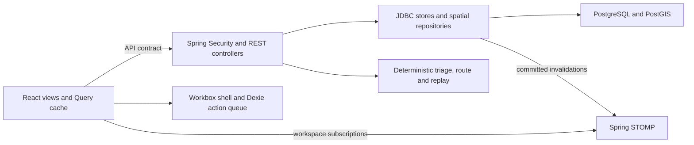

# Plan

**Status** · Complete for the shipped prototype and its scoped exercise acceptance criteria.

The original brief required a reproducible product that could be explored without emergency infrastructure. Codex planned a Java engine, PostGIS operational state and a browser exercise with persistent local work. The participant specified free deployment, later chose Neon for the database and approved a dedicated Vercel frontend. The planning record uses Git and the recorded requests. Architectural fit below is a retrospective explanation where the original session did not record a choice between alternatives. [Record of requests](../CODEX_EVIDENCE_PACK.md#recorded-prompt-excerpts) · [Initial scaffold and plan](https://github.com/Manu577228/HydroGrid/commit/8214ee577bec0b8b5e1c247532d055749d398d08)

## Dependency decisions

| Decision | Observed alternatives or constraint | Selected approach and fit | Trade-off and evidence |
| --- | --- | --- | --- |
| Bounded exercise versus distributed production features | The initial brief listed a full OSM/pgRouting network, Redis GPS and pub/sub, separate services, and model-assisted triage. | Focus the first build on one Spring application, deterministic triage, and Dijkstra over a bounded graph. | The rules and seeded graph are auditable and feasible within the build window. Scale, field data and model generalization are outside that test. [Original reasons and prompt provenance](../CODEX_EVIDENCE_PACK.md#plan) · [Engine source](../../../backend/src/main/java/com/hydrogrid/engine) |
| Application packaging | The initial plan and first releases use one origin. The participant later asked for a Vercel frontend. | Keep the combined Docker release, add a Vercel static frontend, preserve same-origin API paths via rewrite, and connect secure sockets directly to Render. | Two managed hosts require release matching and a strict origin policy. [Local, hosted and fallback topology](../../deployment.md) · [Split release commit](https://github.com/Manu577228/HydroGrid/commit/5d08129b5e08847322d509318c9fd637c7f0c883) |
| Hosted database | The participant specifically changed the hosted database choice from Render to Neon. | Retain PostgreSQL/PostGIS and Flyway. Provision TLS-verified Neon JDBC access and preserve a disposable local Compose database. | Cold readiness and provider quotas remain. [Neon cutover](https://github.com/Manu577228/HydroGrid/commit/ea9a2df98013966656fb65918270227a144e763d) |
| Typed UI and durable browser state | Early contracts needed independent engineering, API and UI workstreams. | React/TypeScript and TanStack Query handle navigation and server state. Dexie retains actions, Workbox caches the shell, and Leaflet/Recharts present maps and metrics. | Clearing site data removes local pending actions. REST reconciliation is necessary after interruption. [Initial frontend](https://github.com/Manu577228/HydroGrid/commit/1b22225305cbdf5493e3913eabc4767bfe7dc310) · [Stack versions and fit](../../engineering.md) |
| Shared operational invariants | Concurrent decisions must never double-assign a unit or exceed a shelter capacity. | Keep lock scope and constraints in Spring/PostgreSQL transactions. Persist audit with the mutation. Emit STOMP invalidations after commit. | One process broker requires REST recovery. Hosted load beyond the tested topology remains unmeasured. [Spatial API](https://github.com/Manu577228/HydroGrid/commit/093ab9b255a686e6eb4763c00121cbec370023bb) · [API contract](../../api.md) |
| Identity and privacy | Guest access, citizen accounts, operator access, and private field sharing represent different permissions. | Use owner-bound demo JWTs and separate account, operator and field scopes. Validate request origin for browser account mutations. | Account recovery and production enrollment require further arrangements. [Identity decisions](../../security.md) · [Workspace ownership](https://github.com/Manu577228/HydroGrid/commit/fbf57f792f3ca88a8cea9e2178fba77a2b6214ea) |
| Dispatch comparison | FIFO was implemented as the comparison baseline. | Reuse one generated workload, graph, flood state, fleet and horizon for FIFO and urgency-aware dispatch. Measure outcomes together. | Synthetic outcomes depend on the workload and horizon. [Engine](https://github.com/Manu577228/HydroGrid/commit/8c5323abe1261cd152f90cee6a0c03940980d6d8) · [Methodology](../../benchmarks.md) |

## Architecture outputs and acceptance

The [architecture guide](../../architecture/README.md) provides system context, technology layers, containers, component boundaries, data flow, deployment and entity relationships. The [workflow suite](../../workflows/README.md) gives the workflow contracts, state machines and failure paths. [Schema source](../../../backend/src/main/resources/db/migration) · [REST and STOMP contracts](../../api.md)

The plan accepts an account-free exercise with durable local pending operations and isolated role state. A runnable image must produce a healthy spatial API, consistent concurrent writes, repeatable seed comparisons and a reproducible browser suite. Geographic routing and weather scope must remain visibly distinct from exercise hazards. [Functional verification](04-test.md) · [Ship checks](07-ship.md)

## Engineering record

Codex decomposed the implementation by contracts and assigned engine, backend and UI workstreams. The root integrated the contract tests, rehearsed Docker deployment and recorded topology adjustments alongside their evidence. The participant directed the deployment cost, data-source and publication constraints. The difficult boundaries were preserving offline receipts across API ownership changes and accounting for browser origin across a proxy. Those cases produced separate ownership tests and a split-origin regression. Framework alternatives beyond the recorded hosting decisions were not independently evaluated.

**Recorded Codex configuration** · `gpt-6.2-sol` / `ultra`, inherited by the recorded workstreams. [Model record D1–D4 and D7](../MODEL_DECISION_LOG.md) · [Capability choices](../CAPABILITY_MATRIX.md) · [Build](03-build.md)
