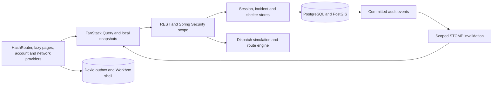

# Build

**Status** · Complete for the released exercise, public source views and protected prototype workspaces. Production agency integration remains outside the implemented workflow.

The build started with versioned engine and API contracts. Delegated Codex agents implemented the deterministic engine, the spatial backend and the browser experience in separate areas. The root reconciled responses, verified integration and added runtime data boundaries. The participant steered the frontend redesign, chose Neon and requested sourced Bengaluru context. [Initial prompt and redesign excerpt](../CODEX_EVIDENCE_PACK.md#recorded-prompt-excerpts) · [Recorded capability use](../CAPABILITY_MATRIX.md)

## Components and data ownership

The React/TypeScript frontend runs from Vite. Tailwind and application CSS support responsive dark and light views, accessible labels and keyboard navigation. Recharts and Leaflet consume scoped data from Query-managed fetches. The frontend owns presentation, drafts, offline receipts and reconnection. [Frontend routing/providers](../../../frontend/src/main.tsx) · [Shell and palette](../../../frontend/src/components/Shell.tsx) · [Manifest and stack](../../engineering.md)

Java 21 and Spring Boot serve REST and STOMP. Spring Security verifies scoped JWTs and separate citizen identity. Controllers validate inputs and return stable HTTP responses. JDBC stores own mutations, the JPA-backed road node repository helps snap coordinates, and PostGIS drives spatial operations. Flyway V1–V5 creates point and line geometry, spatial indexes, scoped IDs, constraints and the owner digest. [Server source](../../../backend/src/main/java/com/hydrogrid) · [DB migrations](../../../backend/src/main/resources/db/migration) · [Architecture and ER diagram](../../architecture/README.md)

## Implemented subsystems

| Subsystem | Input → output and decision | Recovery and verification |
| --- | --- | --- |
| SOS and outbox | A fictional hazard, location and headcount become a local action keyed by a UUID and a server receipt when replayed. A practice note stays on device. [Browser outbox](../../../frontend/src/offline.ts) · [Incident store](../../../backend/src/main/java/com/hydrogrid/store/IncidentStore.java) | Transient errors leave the action pending. The same matching ID returns the existing record. [Real offline reload test](../../../e2e/tests/browser.spec.mjs) |
| Triage, road closure and matching | Report factors feed score and severity. PostGIS derives blocked roads from active polygons, Dijkstra avoids those roads, and the engine ranks available units by fit and route. [Engine](../../../backend/src/main/java/com/hydrogrid/engine) · [Spatial store](../../../backend/src/main/java/com/hydrogrid/store/SpatialGraph.java) | Unreachable or unequipped units stay out of recommendations. The operator can inspect the reasons. [Engine tests](../../../backend/src/test/java/com/hydrogrid/engine) |
| Dispatch and responder | Confirmation locks and updates the exposed assignment. An ordered mission state advances to resolution and releases the unit. [Incident store](../../../backend/src/main/java/com/hydrogrid/store/IncidentStore.java) · [Responder](../../../frontend/src/pages/Responder.tsx) | A lost race returns a conflict. The local queue replays milestones by stable ID after reconnect. [Integration races](../../../backend/src/test/java/com/hydrogrid/HydroGridIntegrationTest.java) |
| Shelter reservation and admission | Accepted headcount reserves space under row lock. Arrival transfers the reservation to admitted count without increasing total occupied and reserved capacity. [Shelter store](../../../backend/src/main/java/com/hydrogrid/store/ShelterStore.java) | Competing writes cannot exceed the check constraint. Test count, concurrency and admission in disposable PostGIS. [Integration suite](../../../backend/src/test/java/com/hydrogrid/HydroGridIntegrationTest.java) |
| Dashboard, audit and live updates | Repeatable-read aggregate results and IST buckets derive from committed workspace state. Scoped STOMP notifications invalidate Query data. [Dashboard controller](../../../backend/src/main/java/com/hydrogrid/api/DashboardController.java) · [Publisher](../../../backend/src/main/java/com/hydrogrid/config/LiveUpdates.java) | Reconnect and visible REST polling reconcile missed invalidations. [Dashboard and STOMP checks](../../../e2e/tests/platform.spec.mjs) |
| Citizen identity and exercise ownership | Account password verification and rotated refresh sessions occupy a distinct scope. An owner proof gates demo roles for each workspace. [Account and demo controllers](../../../backend/src/main/java/com/hydrogrid/api) | Expired or revoked sessions are rejected. Older browser exercise data stays local if ownership needs renewal. [Security scope](../../security.md) · [Account tests](../../../e2e/tests/account.spec.mjs) |
| FIFO and HydroGrid replay | Seed, fleet, report demand, flood and network settings determine one input stream replayed by both policies. Response times and coverage use the 120-minute horizon. [Replay engine](../../../backend/src/main/java/com/hydrogrid/engine/DispatchSimulation.java) | Validated inputs bound work. Determinism, feasibility and trade-offs appear in tests and the nine-run trace set. [Results](../../benchmarks.md) |
| Live Bengaluru, City operations and private GPS | A bounded OSM graph, modeled weather, bulletins, private location sharing and scoped operator observations provide different data layers. [Public routes](../../../frontend/src/pages/Live.tsx) · [Agency view](../../../frontend/src/pages/Operations.tsx) · [Field endpoint](../../../backend/src/main/java/com/hydrogrid/api/FieldController.java) | Degraded sources and old records expose explicit scope and freshness. GPS sharing requires permission and a private field workspace. [Provider and access boundaries](../../operations.md) · [Local fixture tests](../../../e2e/tests/live.spec.mjs) |

The [operational workflow diagrams](../../workflows/README.md) show important sequence and state paths without duplicating the subsystem source.

## Outputs and acceptance

The source progresses from the [engine](https://github.com/Manu577228/HydroGrid/commit/8c5323abe1261cd152f90cee6a0c03940980d6d8), [spatial services](https://github.com/Manu577228/HydroGrid/commit/093ab9b255a686e6eb4763c00121cbec370023bb) and [offline browser](https://github.com/Manu577228/HydroGrid/commit/1b22225305cbdf5493e3913eabc4767bfe7dc310) through the [2.0 role and dashboard pull request](https://github.com/Manu577228/HydroGrid/pull/1). Genuine application captures support a quick visual inspection. A build is accepted when backend checks, browser tests and a deployable image verify these paths. [Product gallery](../../showcase.md) · [Test results](04-test.md)

**Recorded Codex configuration** · `gpt-6.2-sol` / `ultra` for the root and recorded inherited agents. The choice to split work reduced conflicting edits while versioned contract tests checked integration. [Decision log D2–D4](../MODEL_DECISION_LOG.md)
