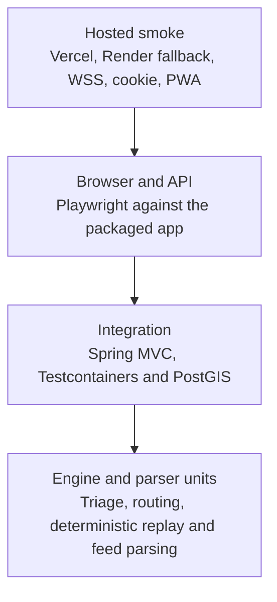
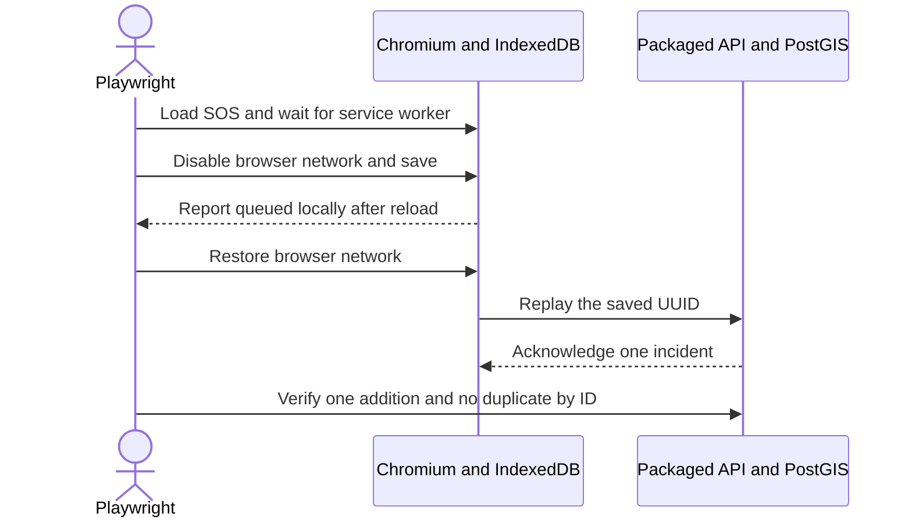
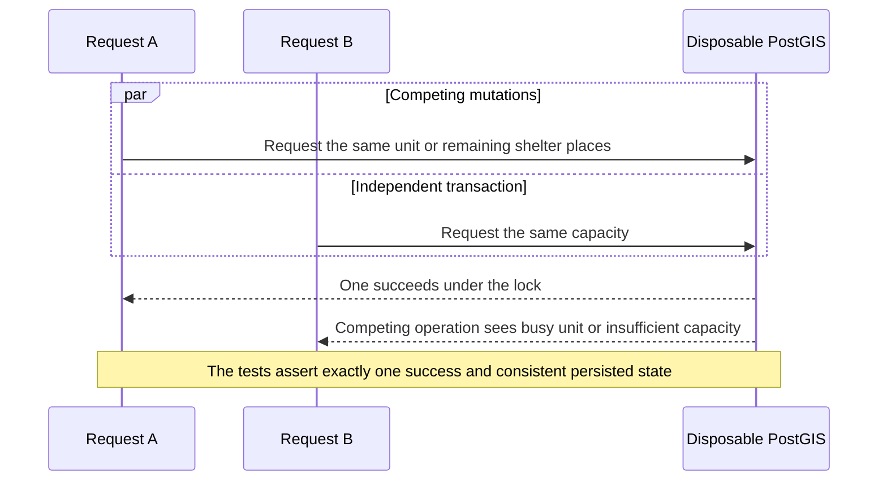
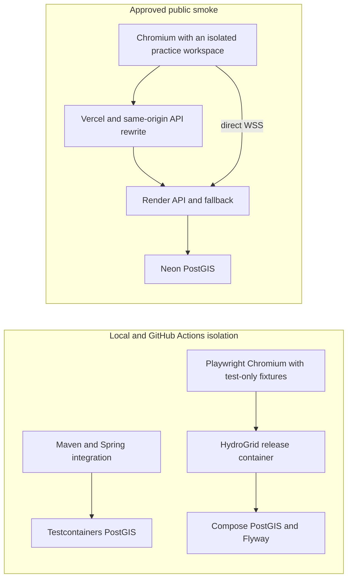

# Test

**Status** · Completed on the verified combined baseline and split release. The scope below distinguishes containers, hosted smoke, and browser automation.

Codex used a narrow engine test, disposable PostGIS integration and full browser workflows for different failure modes. The participant required a working, deployed build with evidence. Automated acceptance includes deterministic routing and replay, workspace isolation, account rotation, conflict and capacity invariants, a browser offline reload and the public Vercel/Render protocols. [Testing report](../../testing.md) · [Recorded test decisions D2, D4–D7](../MODEL_DECISION_LOG.md)

## Requirement-to-test evidence

| Requirement | Check and expected behavior | Verifiable evidence |
| --- | --- | --- |
| Reproducible triage, road network and simulation | Unit tests check factor contributions and matching. A seeded replay returns identical results for identical inputs. The PostGIS graph intersects the active polygon and avoids the blocked direct road. | [Algorithm tests](../../../backend/src/test/java/com/hydrogrid/engine) · [Spatial integration](../../../backend/src/test/java/com/hydrogrid/HydroGridIntegrationTest.java) · [Browser/API replay and routing](../../../e2e/tests/api.spec.mjs) |
| Offline delivery and responder milestones | Disconnection, reload, reconnect and another refresh leave one delivered incident and one of each mission milestone on the server. | [Offline browser scenarios](../../../e2e/tests/browser.spec.mjs) |
| Transactional consistency | Simultaneous requests cannot reserve one busy unit twice or exceed a shelter's available places. A replayed mission update and admission retain consistent state. | [PostGIS race tests](../../../backend/src/test/java/com/hydrogrid/HydroGridIntegrationTest.java) |
| Authorization and revocation | Workspace proof gates tokens and topic reads. Account refresh and logout preserve session invariants. Split-origin tests require exact Origin and browser metadata, and check a successful first-party account login and logout. | [Ownership and STOMP tests](../../../e2e/tests/api.spec.mjs) · [Account integration](../../../backend/src/test/java/com/hydrogrid/CitizenAccountIntegrationTest.java) · [Account browser flow](../../../e2e/tests/account.spec.mjs) |
| Real-time updates and UI behavior | Committed updates reach the exercise over STOMP and change its dashboard. Keyboard search survives a delayed route change, themes persist, and dispatch waits for explicit confirmation. | [Dashboard regression](../../../e2e/tests/platform.spec.mjs) · [Keyboard fix PR](https://github.com/Manu577228/HydroGrid/pull/2) |
| Private field and agency workspace | The loopback fixture writes an opted-in test fix and checks an enrolled operator’s observation and handoff. Hosted checks leave these private write cases skipped. | [Field fixture](../../../e2e/tests/live.spec.mjs) · [Operator fixtures](../../../e2e/tests/operations.spec.mjs) |
| Responsive and accessible states | Chromium navigates the mobile menu and the axe runner checks named states at six widths and two themes. | [Browser navigation](../../../e2e/tests/browser.spec.mjs) · [Accessibility runner](../../../e2e/accessibility.mjs) · [Testing results](../../testing.md) |

## Failure-mode sequences

The [deployment topology](../../architecture/README.md) separates browser fixture, app and database. GitHub Actions follows the [automated pipeline](08-automate.md). The environment deliberately starts a disposable PostGIS for integration and a Compose service for browser checks.

## Exact verified outcomes

| Revision | Environment | Outcome |
| --- | --- | --- |
| [940edb0](https://github.com/Manu577228/HydroGrid/commit/940edb064d90053414370addb871f6b33e997e93) | Original combined release | 24 Java plus 17 isolated Playwright checks passed. Hosted subset 14 passed, three fixture cases skipped. [Passing CI](https://github.com/Manu577228/HydroGrid/actions/runs/45938609328) |
| [5d08129](https://github.com/Manu577228/HydroGrid/commit/5d08129b5e08847322d509318c9fd637c7f0c883) | Split release | 25 Maven, 17 local Playwright, 15 Vercel browser/API and three targeted Render fallback passes. Two private write cases skipped on Vercel. Latest production verification recorded 120 hosted axe, overflow and browser-error checks without findings in the sampled states. [Passing CI](https://github.com/Manu577228/HydroGrid/actions/runs/45970866151) · [Public checks](../../deployment.md) |
| [de1f044](https://github.com/Manu577228/HydroGrid/commit/de1f0447718be73a71650f233a6430ff865339cb) | Current evidence audit | 25 local Maven and 17 local Playwright passed. A warm isolated Vercel rerun passed 14 and skipped three gated tests, followed by three successful targeted offline SOS runs. The first hosted pass timed out waiting for delivery and also had a colliding trace-output path. [Branch CI](https://github.com/Manu577228/HydroGrid/actions/runs/45972012099) · [Testing report](../../testing.md) |

Codex corrected transient startup retries, historical browser navigation timing and tested both providers after the split. The retry after a Maven Central HTTP 429 addressed an external dependency failure. The accessibility checks cover named sampled routes and states. No measured line, branch or manual accessibility coverage percentage is recorded. [Finding history and corrections](05-review.md)

**Recorded Codex configuration** · `gpt-6.2-sol` / `ultra`. Test depth came from selecting checks for the relevant failure mode and using exact revisions. [Model and test evidence](../MODEL_DECISION_LOG.md)
