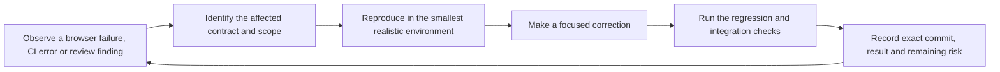

# Review

**Status** · Source and regression review complete for the documented findings. Production assurance and ongoing operational risk are separate.

Codex assigned a fresh source workstream during the competition audit. The root integrated findings and repeated the highest-risk integration checks. Earlier hosted smoke and CI runs supply independently reproducible timing and readiness failures. The participant asked for both engineering corrections and explicit publication approval. GitHub PRs provide the reviewed diffs. The record contains no automated `@codex` PR review. [Evidence request](../CODEX_EVIDENCE_PACK.md#recorded-prompt-excerpts) · [Issue register](../REVIEW_FINDINGS.md)

| Review scope | Discovery and root cause | Mitigation and acceptance check |
| --- | --- | --- |
| Frontend keyboard and accessibility | Hosted smoke exposed a palette closed by an unrelated path transition. Automated review also found unlabeled controls and weak chart contrast. | Remove the route-triggered close, test deliberate lazy-route delay, give controls accessible names and verify sampled layouts. [Keyboard PR](https://github.com/Manu577228/HydroGrid/pull/2) · [Redesign PR](https://github.com/Manu577228/HydroGrid/pull/1) |
| Database and API consistency | Source review focused on shared unit state, capacity and repeat delivery. Concurrent requests could be unsafe if authorization, locks, audit and mutation occurred in distinct scopes. | Concurrent dispatch and shelter capacity tests verify implemented row locks. Workspace and stable client IDs protect retry semantics. [Integration cases](../../../backend/src/test/java/com/hydrogrid/HydroGridIntegrationTest.java) · [Offline and contention diagrams](../../workflows/README.md) |
| Identity, isolation and offline recovery | An older demo identifier lacked independently held owner proof. A separate logout race involved competing redirects. The split frontend introduced a new origin boundary. | Introduce owner proof while retaining unsent local records, remove competing profile routes, enforce exact alias and browser metadata, verify token and cookie behavior. [Ownership correction](https://github.com/Manu577228/HydroGrid/commit/fbf57f792f3ca88a8cea9e2178fba77a2b6214ea) · [Dependency and logout correction](https://github.com/Manu577228/HydroGrid/commit/70492a2686019d8c58c4e0fee93f536617b9bec9) · [Split integration](https://github.com/Manu577228/HydroGrid/commit/5d08129b5e08847322d509318c9fd637c7f0c883) |
| Deployment and failure handling | Cold startup could reset connections during readiness. Builds also saw a transient upstream Maven HTTP 429. | Bound the probe retries and record the upstream dependency incident. Recheck both app entry points and CI completion. [Startup correction](https://github.com/Manu577228/HydroGrid/commit/8df1d6a61e8f6337c480c38211baec1a0a4d00f3) · [Verified split CI](https://github.com/Manu577228/HydroGrid/actions/runs/45970866151) |
| Dependencies, performance and documentation | Audit inspected build pins, public JSON parsing and JDBC TLS support. Timings covered warm local samples. Early documentation mixed historical lifecycle wording and release states. | Upgrade audited dependency patch versions and verify local and hosted app behavior. Map scope, timing denominators, stage names and release identity to source. [Security findings](../../security.md) · [Timing method](../../testing.md) · [Evidence traceability](../TRACEABILITY_MATRIX.md) |

Security analysis follows the browser, API, STOMP, database and external provider trust boundaries in the [architecture guide](../../architecture/README.md) and [security documentation](../../security.md). The issue register gives severity, discovery, correction, changed source links, test outcomes and commits for genuine findings. The table above also includes invariants that review confirmed without identifying a defect.

Codex used a separate reviewer so the implementation assumptions could be challenged, then used tool outputs rather than review opinion as the corrective acceptance gate. The participant owns risk decisions and authorized the split rollout separately from publication of this documentation. No production credential, private emergency report or real field outcome is included in the review artifacts.

**Recorded Codex configuration** · `gpt-6.2-sol` / `ultra` across the root and verified inherited review workstream. [Decision log D4–D8](../MODEL_DECISION_LOG.md) · [Review findings](../REVIEW_FINDINGS.md) · [Test results](04-test.md)
