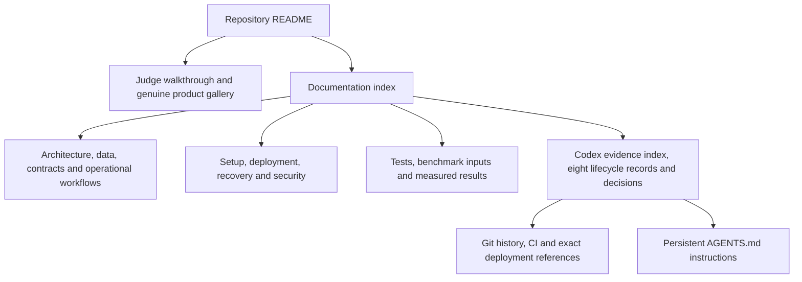

# Document

**Status** · The repository documentation and evidence are assembled for review. Public availability follows the documented branch and participant approval.

The participant asked for a judge-ready README, source-linked documentation and genuine Codex evidence. Codex audited the repository, existing rollout records and previously captured outputs. A separate workstream compared the browser guide with actual controls and recorded the exercise on an isolated app. This audit turns the previously compact evidence into individually inspectable lifecycle records. [Recorded brief](../CODEX_EVIDENCE_PACK.md#recorded-prompt-excerpts) · [Documentation commit](https://github.com/Manu577228/HydroGrid/commit/fda9b8edc7609aab0458f30429c9b1491a86999a)

| Reader or task | Supporting documents and evidence |
| --- | --- |
| Judge runs one exercise | [90-second guide and extended walkthrough](../../demo.md) · [Product screenshots](../../showcase.md) · [Two-minute video script](../../demo-script.md) |
| Engineer traces architecture and workflows | [Architecture and ER diagrams](../../architecture/README.md) · [Operational workflow diagrams](../../workflows/README.md) · [API contracts](../../api.md) · [Implementation and rationale](../../engineering.md) |
| Developer reproduces verification | [Local setup](../../setup.md) · [Java, browser, accessibility and smoke checks](../../testing.md) · [Benchmark methodology and all measured seeds](../../benchmarks.md) |
| Operator interprets deployment and data boundaries | [Deployment and recovery](../../deployment.md) · [Release history](../../release-2.0.md) · [Security and privacy](../../security.md) · [Source terms](../../attribution.md) · [Agency operations](../../operations.md) |
| Reviewer audits agent and human decisions | [Evidence Pack](../CODEX_EVIDENCE_PACK.md) · [Model log](../MODEL_DECISION_LOG.md) · [Capability matrix](../CAPABILITY_MATRIX.md) · [Traceability](../TRACEABILITY_MATRIX.md) · [Repository instructions](../../../AGENTS.md) |

## Evidence and acceptance

Codex replaced outdated stage labels with the supplied eight names, preserved the older history as evidence, and separated exact Git, test and deployment results from narrative interpretation. It tested the judge guide with browser network disconnection, reload, linked shelter admission and the benchmark comparison. The imagery shows the actual release. The landing illustration is identified independently in the gallery and capability record.

Important checks for acceptance include relative links and anchor resolution, Mermaid compilation or rendering, screenshots that contain only the synthetic and public data they describe, and reproduction commands verified on the named scope. Use the [documentation index](../../README.md) to follow these references. The [release notes and latest testing results](../../testing.md) establish app check outcomes. Browser screenshot and model metadata records expose selected public-safe fields.

The initial document audit used `gpt-6.2-sol` at `ultra`, inherited by the evidence and demo agents. The later architecture and lifecycle audit used the recorded root configuration. The participant requested diagram depth, evidence fidelity and approval before publication. [Model records D6 and D8](../MODEL_DECISION_LOG.md) · [Ship](07-ship.md)
