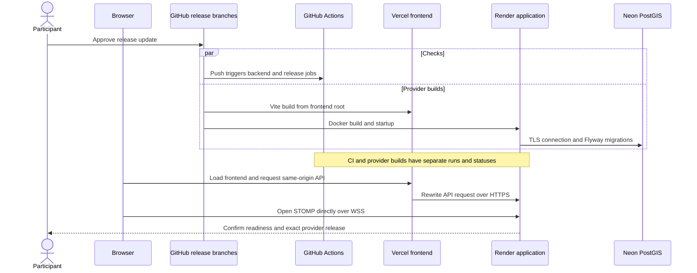

# Ship

**Status** · The combined Render fallback and the dedicated Vercel rollout are live and verified at the deployment record’s revisions. The participant authorized publication of this documentation to the submission branch.

The participant chose Neon PostgreSQL and approved successive releases, including the dedicated frontend. Codex prepared Git changes, checked provider revision status, ran deployment verification and recorded recovery scope. The original combined build was reviewed through PRs #1 and #2. Vercel follows `submission-final-audit`. The Render service now follows `main`, where PR #3 merged the same tested application files. [Release PR](https://github.com/Manu577228/HydroGrid/pull/1) · [Keyboard correction PR](https://github.com/Manu577228/HydroGrid/pull/2) · [Release record](../../deployment.md)

## Packaged and deployed environments

| Environment | Topology | Evidence |
| --- | --- | --- |
| Local reproducible release | Compose starts PostGIS, builds React and the Java application, and serves static pages, REST and sockets through one loopback origin. | [Compose and Docker build](../../../compose.yaml) · [Setup](../../setup.md) |
| Historical combined release | Render built the root Dockerfile at 940edb0. Neon carried the database and applied Flyway migrations. | [CI](https://github.com/Manu577228/HydroGrid/actions/runs/45938609328) · [Historical deploy record](../../release-2.0.md) |
| Verified split rollout | The Vercel frontend rewrites `/api/*` to Render while handling account cookies in the browser’s first-party scope. Browser STOMP connects directly to Render WSS. Neon keeps PostGIS persistent. Render also serves its combined fallback. | [Integration commit](https://github.com/Manu577228/HydroGrid/commit/5d08129b5e08847322d509318c9fd637c7f0c883) · [Recorded provider deploy IDs](../../deployment.md) · [Rewrites](../../../frontend/vercel.json) · [Render blueprint](../../../render.yaml) |

## Verification gates and recovery

1. Match the source revision and exact provider build, then inspect the separate [CI result](https://github.com/Manu577228/HydroGrid/actions/runs/45970866151). The engineering acceptance gate checks both provider health URLs and an actual browser, since Render’s landing-page probe does not prove Neon readiness. [Vercel health](https://hydrogrid-response.vercel.app/api/health) · [Render health](https://hydrogrid-demo-7v9f.onrender.com/api/health)
2. Exercise mobile navigation, scoped REST and direct STOMP. Check the host-only Secure/HttpOnly/Strict cookie attributes and confirm direct cross-site request rejection. Private GPS and agency write fixtures remain local. [Production smoke and CI](../../testing.md) · [Security](../../security.md)
3. The startup build applies versioned Flyway migrations and checks the seeded graph on the health endpoint. A cold free-host wake can interrupt an initial browser run. Retry through readiness and re-run the functional checks. [Migrations](../../../backend/src/main/resources/db/migration) · [Deployment troubleshooting](../../deployment.md)
4. If a corrective release must roll back, choose a prior artifact with compatible schema and access rules. Image rollback keeps the existing database and migration history. The earlier V3 artifact started against V5 in isolated Compose, but lacked the newer owner-proof protection. That narrow test does not approve a production rollback. [Tested recovery limit](../../deployment.md#recover-or-roll-back)

[Live Vercel frontend](https://hydrogrid-response.vercel.app/) · [Combined Render fallback](https://hydrogrid-demo-7v9f.onrender.com/) · [Production topology and verification diagrams](../../architecture/README.md)

**Recorded Codex configuration** · `gpt-6.2-sol` / `ultra`. Provider-specific commands and scoped browser checks gave direct evidence for rollout behavior and preserved participant approval. [D3, D5 and D7](../MODEL_DECISION_LOG.md) · [Automate](08-automate.md)
