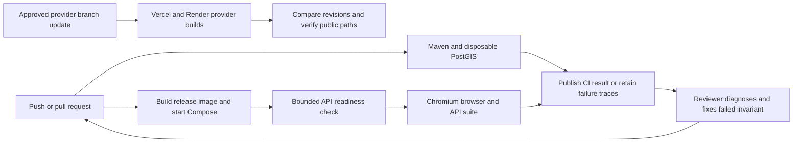
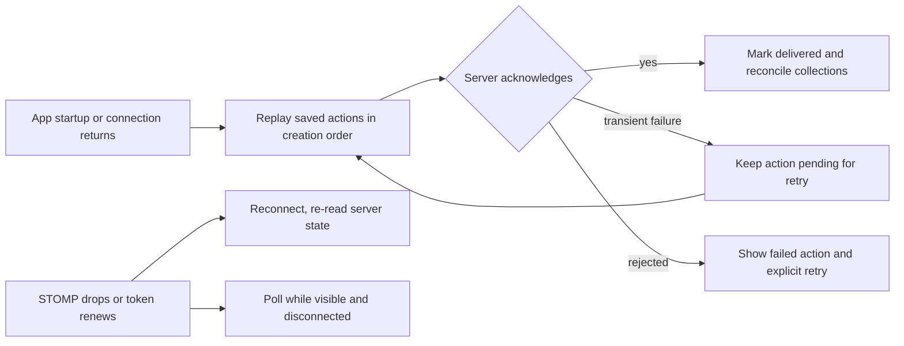
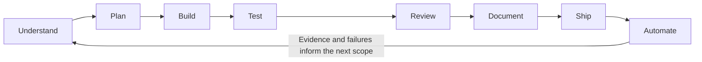

# Automate

**Status** · The repository runs CI and runtime automation described here. Hosted deployments follow the approved tracked branch. The evidence does not record a Codex schedule or an automated Codex PR review.

Codex added Maven, container and Playwright checks, addressed startup transient errors, and extended benchmark and accessibility tooling. Provider Git integrations publish approved branch updates. Persistent instructions carry commands and boundaries into subsequent Codex sessions. The participant directed the free-host and approved-release requirements. [AGENTS.md](../../../AGENTS.md) · [Versioned CI](../../../.github/workflows/ci.yml) · [Recorded capability use](../CAPABILITY_MATRIX.md)

## Engineering lifecycle automation

| Trigger | Inputs and execution | Output, failure handling and evidence |
| --- | --- | --- |
| GitHub push or pull request | On Ubuntu, Java 21 executes Maven verification. The release job installs locked Node packages and Chromium, builds Compose and probes the API with bounded retries. | Tests affect the run result. Failure prints service logs and retains browser traces, and cleanup always runs. [Workflow](../../../.github/workflows/ci.yml) · [Successful split CI](https://github.com/Manu577228/HydroGrid/actions/runs/45970866151) |
| On-demand benchmark | A Node tool requests paired policies from the configured running app with fixed seeds and sizes, and checks trace consistency. | A failed run surfaces a non-success response or invariant failure. Successful runs export inputs and comparative results. [Runner](../../../deploy/benchmark.mjs) · [Raw study](../../data/dispatch-study.json) |
| On-demand accessibility scan | Playwright and axe inspect specified themes, viewports and data-backed page states. | Browser exceptions, overflow or axe findings fail the runner. [Scanner](../../../e2e/accessibility.mjs) · [Verification scope](../../testing.md) |
| Approved provider branch update | Vercel builds the frontend from `submission-final-audit`. Render builds the combined Java container from `main`. The apps use the existing managed database and environment configuration. | Provider status identifies the revision. Public health, browser, cookie and WSS checks verify the result. CI and provider builds run separately. [Delivery and rollback](../../deployment.md) |

## Runtime automation

Workbox precaches the shell. The page-level Dexie synchronization coordinator handles boot, intervals, connectivity changes and explicit retries. An app opened or reopened with connectivity can replay retained actions. The STOMP adapter reconnects and refetches. The visible exercise falls back to HTTP polling when a live socket is unavailable. [Outbox](../../../frontend/src/offline.ts) · [Page network state](../../../frontend/src/network.tsx) · [Realtime client](../../../frontend/src/api.ts)

Flyway applies migrations on app startup. Spring jobs expire inactive exercise sessions, private field records, old account sessions and eligible operator records. Scheduled jobs run when the application is awake. Retention and source limits are described in the security and operations docs. [Migrations](../../../backend/src/main/resources/db/migration) · [Exercise cleanup](../../../backend/src/main/java/com/hydrogrid/store/SessionStore.java) · [Field cleanup](../../../backend/src/main/java/com/hydrogrid/api/FieldController.java) · [Account and operator cleanup](../../../backend/src/main/java/com/hydrogrid/api)

## Improvement and acceptance

A transient connection reset originally broke readiness. The correction retries all transient errors within a bounded window. Follow-up source tooling converts one-off accessibility and benchmark checks into repeatable commands. Versioned automation passes on the named release and preserves inspectable outputs. [Probe fix](https://github.com/Manu577228/HydroGrid/commit/8df1d6a61e8f6337c480c38211baec1a0a4d00f3) · [Reproducible tooling commit](https://github.com/Manu577228/HydroGrid/commit/2adc58bc9ae2b385768767dcead4d3e919e4776a)

**Recorded Codex configuration** · `gpt-6.2-sol` / `ultra`. Tool and provider behavior was verified directly. [Model choices D2, D3, D5–D8](../MODEL_DECISION_LOG.md) · [Stage evidence index](../CODEX_EVIDENCE_PACK.md)
