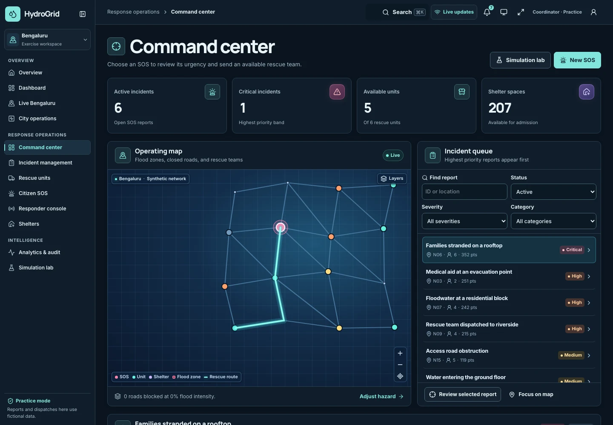
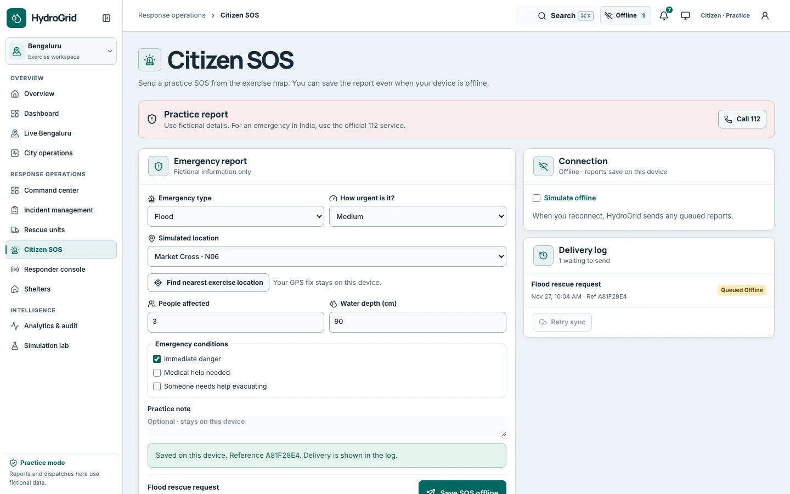
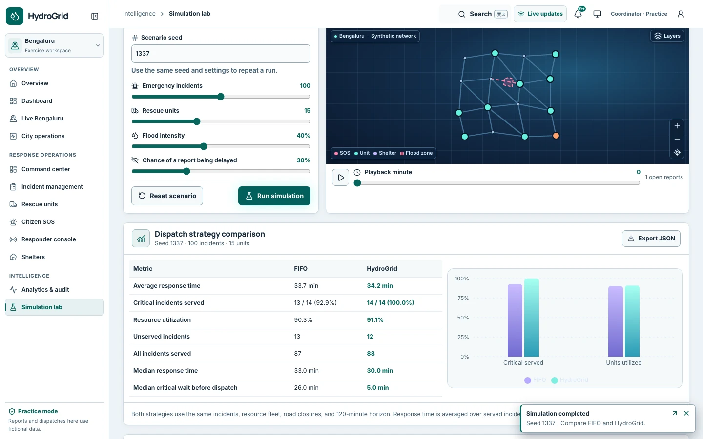

# HydroGrid 2.0 showcase

These are Chromium screenshots of the 2.0 release from the isolated QA app. Desktop captures use a 1440-pixel viewport and the mobile example uses a 390-pixel viewport. All reports, shelter counts and dispatched resources shown belong to the fictional exercise. Screens with a real-world source are marked separately. [Try the guest exercise](https://hydrogrid-demo-7v9f.onrender.com/) · [Walkthrough](demo.md)

| Screen | What to look for |
| --- | --- |
| [Landing page](screenshots/overview.webp) | Start the exercise without an account. The atmospheric aerial is an illustration. |
| [Dashboard, dark](screenshots/dashboard-dark.png) · [Dashboard, light](screenshots/dashboard-light.webp) | Current exercise metrics, priority distribution, map and time-window controls. |
| [Command center map](screenshots/command.webp) · [Triage and recommendation](screenshots/command-triage.webp) | Work through a ranked queue and inspect scored priority, eligible unit, spare capacity and simulated travel. |
| [Incident register](screenshots/incidents.webp) · [Rescue unit roster](screenshots/units.webp) | Scope the records by incident state, severity or fleet availability. |
| [Analytics & audit](screenshots/analytics.webp) | Committed incident, dispatch, field and shelter activity from one browser exercise. |
| [Citizen SOS, desktop](screenshots/sos-desktop.webp) · [Citizen SOS, mobile light](screenshots/practice-sos-mobile.png) · [Queued SOS](screenshots/sos-queued.webp) | The mobile-friendly SOS form uses fictional details. The queued state comes from an actual Chromium disconnection. |
| [Responder console](screenshots/responder.webp) | The selected assignment shows the route, equipment and recorded response milestones. |
| [Shelter admission](screenshots/shelters.webp) | A three-person case changes from reserved to admitted after check-in. |
| [Simulation playback](screenshots/simulation-playback.webp) · [Policy comparison](screenshots/simulation-comparison.webp) | Replay seed 1337 and read the tradeoff in critical incidents served and mean response times. |
| [Live Bengaluru](screenshots/live-bengaluru.webp) | Public Bengaluru streets and landmarks. Weather estimates and official bulletins have their own source and freshness information. |
| [Sign-in](screenshots/sign-in.webp) · [Registration](screenshots/registration.webp) | Separate citizen account screens using empty forms. The guest exercise remains available. |

*The Command center displays the synthetic operating network and the incident queue together.*

*The browser’s network was disabled through Playwright. The saved report survived an offline reload in the exercise.*

*The comparator reports both policies on the same inputs. All three published seeds and tradeoffs are in the benchmark report.*

[Benchmark report](benchmarks.md) · [Video storyboard](demo-script.md) · [Data attributions](attribution.md)
