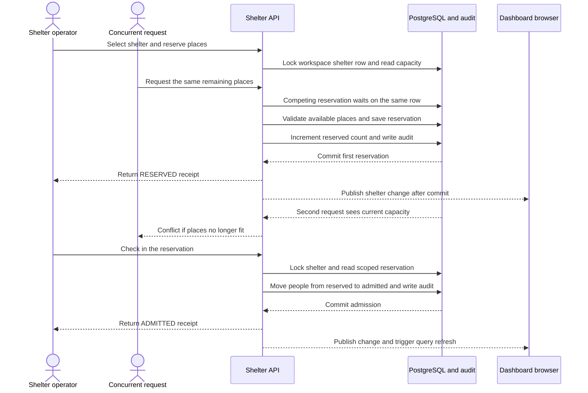
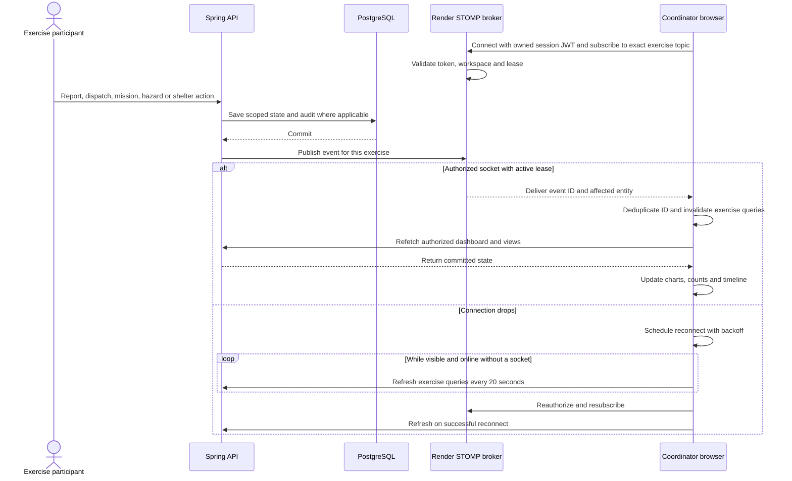

# Shelter and dashboard coordination

## Shelter coordination

The API permits exercise Shelter and Coordinator roles. Recommendations use incident headcount, shelter type for a medical case, current available places, and reachability. A reservation independently validates the requested headcount and any linked workspace incident. It increases reserved occupancy. Admission subtracts the same group from reserved and adds it to admitted. **Available = capacity − reserved − admitted**, so availability falls when reserved, then stays the same when that group is checked in.

The shelter-row lock guards both mutations. A competing request waits and checks the reduced capacity after the first transaction commits. PostgreSQL also constrains the sum of reserved and admitted to capacity. Matching request IDs return the previous reservation, conflicting ID reuse fails, and repeated admission returns the already-admitted record. The workflow manages seeded exercise places. Authorized real facility observations use the separate operator board. [Shelter store](../../backend/src/main/java/com/hydrogrid/store/ShelterStore.java) · [Database constraints](../../backend/src/main/resources/db/migration/V1__hydrogrid.sql) · [Reservation race test](../../backend/src/test/java/com/hydrogrid/HydroGridIntegrationTest.java) · [Operator board](../operations.md)

## Real-time dashboard updates

The Vercel browser connects directly to Render over WSS for STOMP. The Render fallback uses its same-origin socket. The exact allowed frontend origin protects the cross-origin handshake, and the STOMP interceptor validates the token and permits subscriptions only to the token's workspace. Clients send mutations through REST. They keep a rolling set of 100 event IDs and treat each accepted message as a signal to fetch authoritative state. Publishing happens after transaction commit. The dashboard reads its aggregates in a repeatable-read transaction. The broker runs in the backend process and disconnected clients reconcile via REST. It has no durable replay. [STOMP authorization](../../backend/src/main/java/com/hydrogrid/config/WebSocketConfiguration.java) · [After-commit listener](../../backend/src/main/java/com/hydrogrid/config/LiveUpdates.java) · [Browser connection](../../frontend/src/api.ts) · [Polling fallback](../../frontend/src/network.tsx) · [Dashboard queries](../../backend/src/main/java/com/hydrogrid/api/DashboardController.java)
