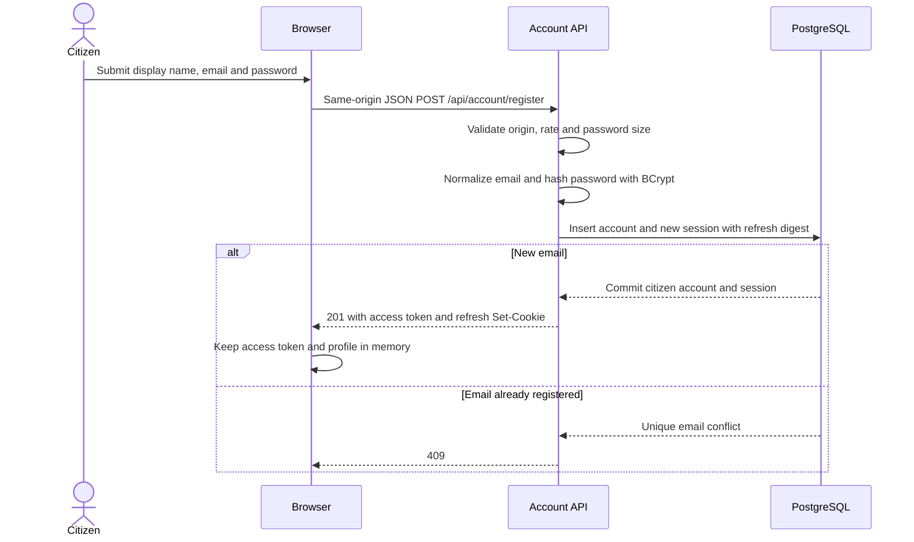
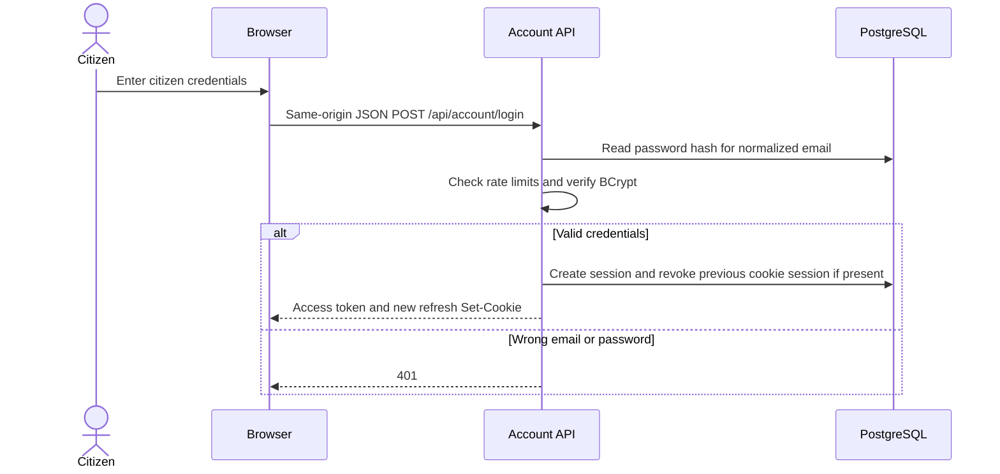
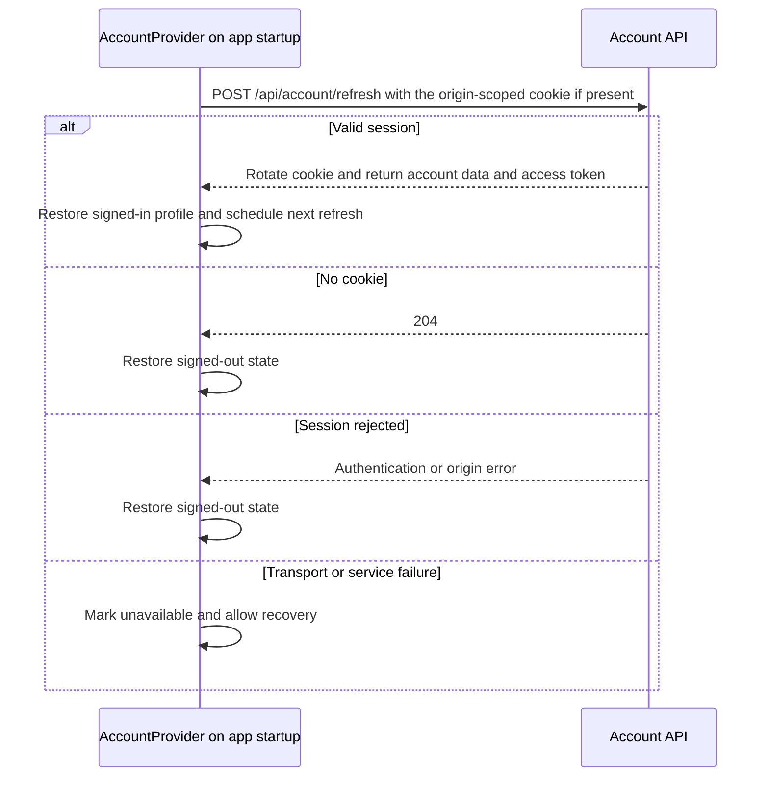
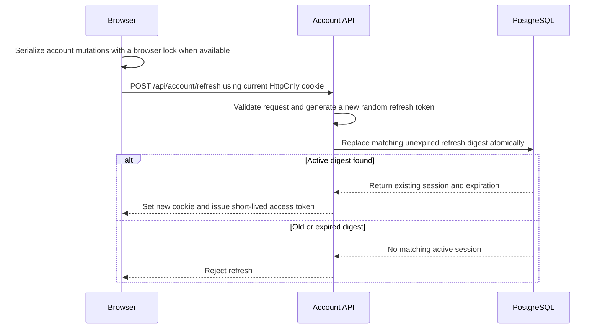
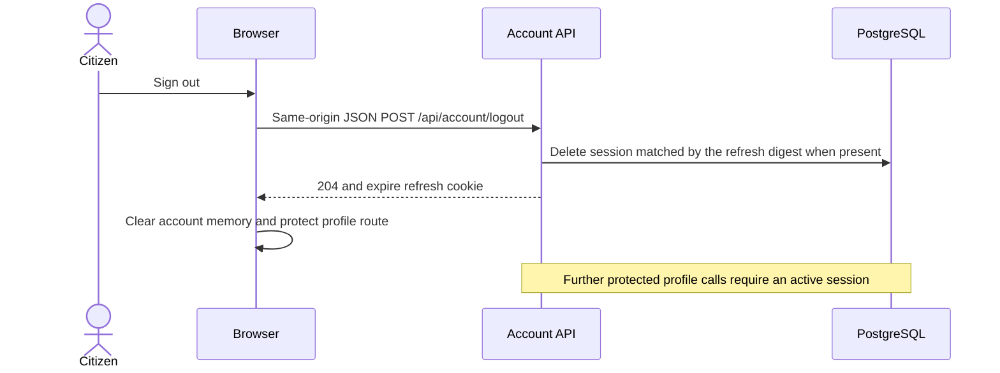
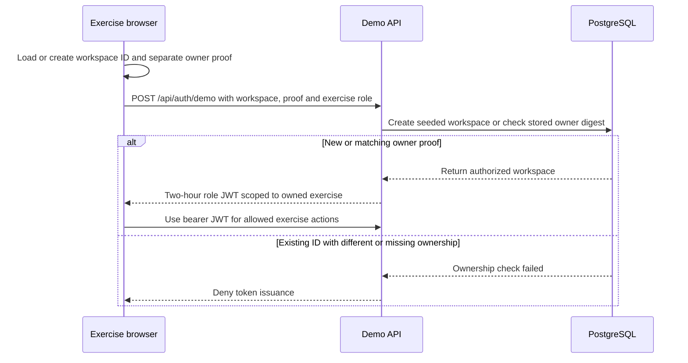
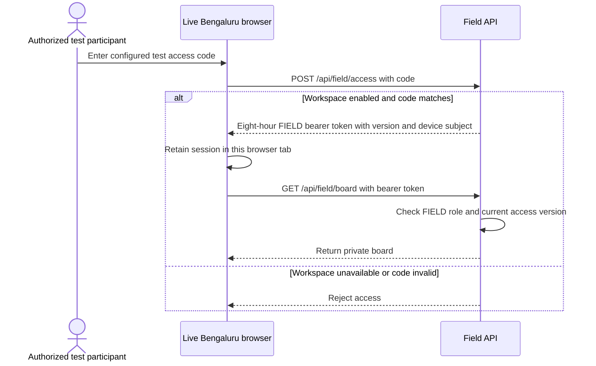

# Authentication lifecycles

Citizen accounts, owned practice workspaces and the private field board have distinct credentials. Exercise, operator and field roles use their own access checks. The public Vercel app uses first-party HTTP requests through an API rewrite. Render accepts the exact Vercel origin on secure requests with same-origin browser metadata. The combined Render fallback keeps its own first-party path. [Security](../security.md) · [Deployment](../deployment.md#dedicated-vercel-frontend)

## Registration

The public form creates a citizen profile. The password limits are at least 12 code points and at most 72 UTF-8 bytes. The server stores the password hash and the refresh digest. Registration is rate-limited, and credential verification runs in a bounded pool.

## Login

The server calculates against a placeholder BCrypt hash for an unknown email. Active profile requests require the JWT to resolve to a valid account session. Login and registration can reject a request before writing when rate or validation checks fail. [Account endpoint implementation](../../backend/src/main/java/com/hydrogrid/api/AccountController.java)

## Session restoration

The access token lives in memory. The browser uses the cookie to restore after a reload. A restore call checks again when an unavailable client comes online. The cookie is host-only with `HttpOnly`, `SameSite=Strict`, `Path=/api/account` and `Secure` on HTTPS. Each origin has its own sign-in cookie. [Browser account provider](../../frontend/src/account.tsx)

## Refresh-token rotation

The account session expires 14 days after creation. Rotation keeps that deadline. The access token expires after up to 10 minutes. Concurrent reuse of the old digest can succeed once because the database updates the matching digest atomically. The browser uses Web Locks when available and a local request queue otherwise. [SQL rotation and profile checks](../../backend/src/main/java/com/hydrogrid/api/AccountStore.java) · [Browser refresh](../../frontend/src/account.tsx)

## Logout

Logout revokes the current matching session. The protected profile route sends signed-out users to login. Browser-owned exercises and the local outbox have their own credentials. [Logout implementation](../../backend/src/main/java/com/hydrogrid/api/AccountController.java) · [Profile route](../../frontend/src/pages/Account.tsx)

## Demo workspace access

The proof is random and independent of the workspace ID. Both are origin-local browser storage. Knowing the ID alone cannot reopen the workspace. These tokens apply to practice actions. [Demo token issuance](../../backend/src/main/java/com/hydrogrid/api/DemoController.java) · [Ownership and seed](../../backend/src/main/java/com/hydrogrid/store/SessionStore.java) · [Browser credentials](../../frontend/src/api.ts)

## Private field workspace access

A FIELD token gives access to the shared test board, subject to its access version and expiration. Exercise and operator roles are authorized separately. Location sharing starts with an explicit action. When the configured access changes, version checks invalidate prior tokens. The board is intended for authorized testers. [Field access checks](../../backend/src/main/java/com/hydrogrid/api/FieldController.java) · [GPS workflow](live-data.md#device-permission-and-private-sharing)
