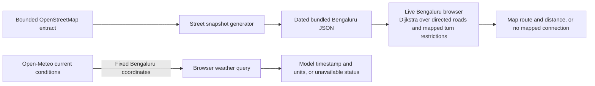
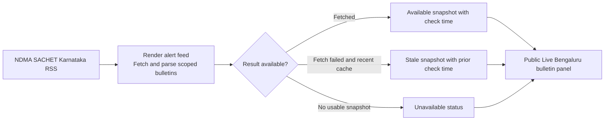
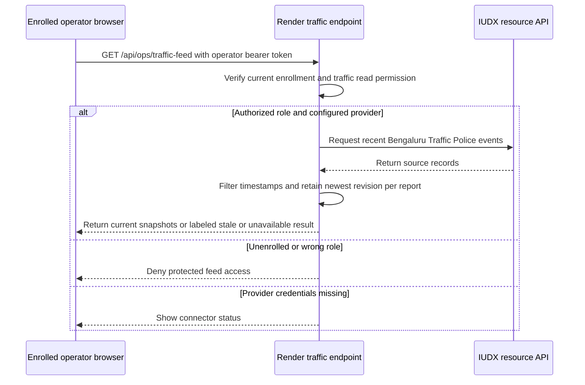
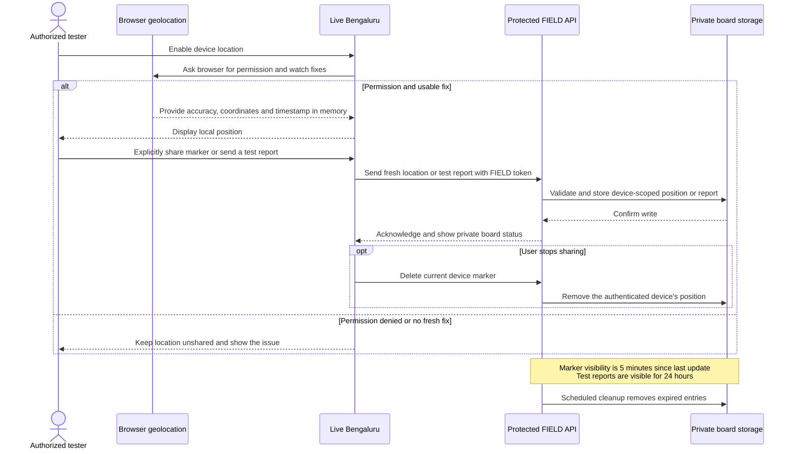

# Live information and GPS

Live Bengaluru and City operations separate sourced public feeds, restricted traffic records, and explicitly shared device data. The exercise uses a separate synthetic graph, incidents, fleets, and shelters. Its flood intensity control never changes a sourced street route. [Data attribution](../attribution.md) · [City operations](../operations.md)

## Public streets and weather

The browser draws a bounded, bundled street snapshot between mapped landmarks. The route minimizes mapped road distance and respects the turn restrictions included in the extract. Unknown or disconnected endpoints have no route preview. The snapshot date, coverage and attribution accompany the map. The weather query uses fixed Bengaluru coordinates and refreshes periodically while active. It displays model estimates for the configured coordinates. The app links official weather guidance separately. [Snapshot source and coverage](../../frontend/public/geography/README.md) · [Browser street router](../../frontend/src/geography.ts) · [Weather query](../../frontend/src/liveWeather.ts)

## Official bulletins

The backend reads a fixed source and refreshes its cache on a five-minute interval when requested. A fetch failure can serve a prior successful snapshot marked stale for up to 24 hours. An unavailable feed returns its status and no items. The browser shows the publisher, check time and bulletin dates. Empty or unavailable data provide no evidence that an area is safe. [Bulletin retrieval](../../backend/src/main/java/com/hydrogrid/api/AlertFeed.java) · [Public conditions panels](../../frontend/src/components/LiveConditions.tsx)

## Configured traffic data

Provider credentials stay on Render. The connector checks a recent two-hour window and limits the published result to 25 records. It identifies a closure using provider fields and shows event and check times. Traffic snapshots are kept in server memory and displayed to authorized traffic viewers, traffic operators, or coordinators. The street router reads only its bundled street graph. [Traffic controller](../../backend/src/main/java/com/hydrogrid/api/TrafficFeedController.java) · [Provider integration](../../backend/src/main/java/com/hydrogrid/api/TrafficFeed.java) · [Source authorization and recency](../operations.md#connect-the-iudx-traffic-feed)

## Device permission and private sharing

Location requires a secure browser and a user action. The browser keeps a fix local until an authorized tester starts sharing or sends a test report. A fix must be fresh to publish. While sharing is active, the app attempts to update the marker every 10 seconds and retries after an update failure. Other authorized testers see the latest successful marker until it is deleted or five minutes elapse. Test reports use an idempotent device-scoped ID. Visibility windows apply on every board read and a separate cleanup task removes old records every 15 minutes while the backend is running. The private board records test submissions for authorized participants. [Geolocation permission](../../frontend/src/deviceLocation.ts) · [Sharing and failure handling](../../frontend/src/fieldWorkspace.ts) · [Board visibility and expiration](../../backend/src/main/java/com/hydrogrid/api/FieldController.java)
