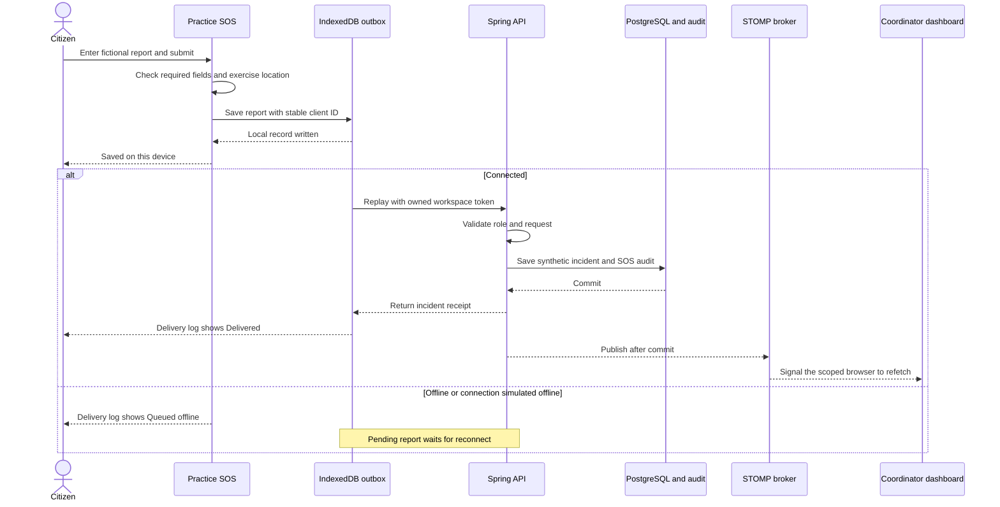
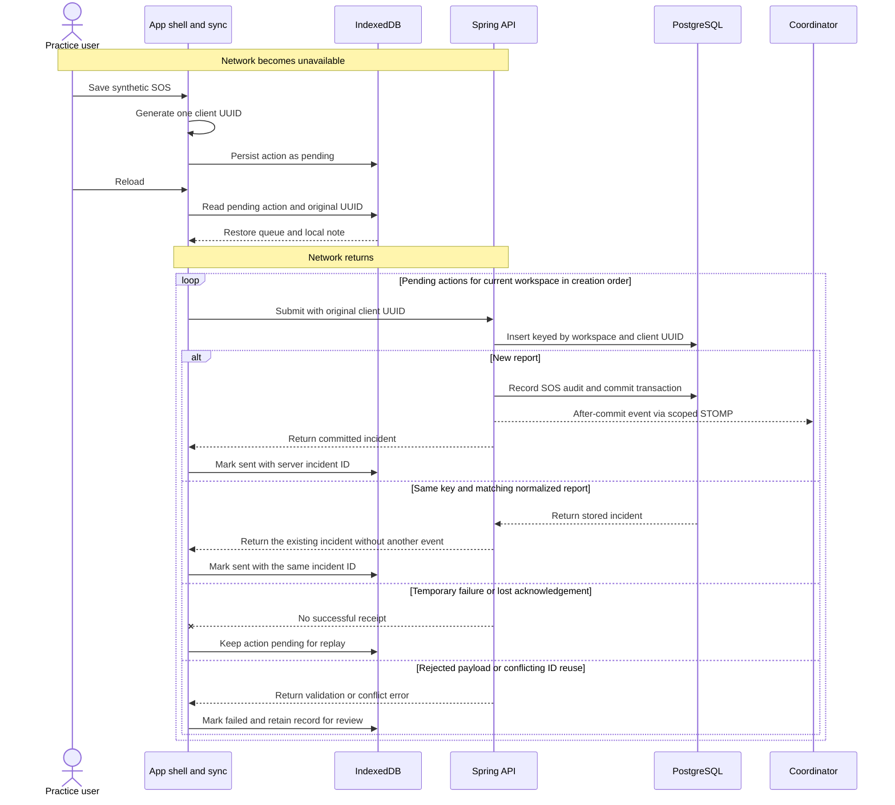

# Reporting and offline synchronization

## Citizen SOS lifecycle

The practice form collects a fictional hazard, a location from the exercise map, headcount, reported urgency and incident factors. Browser form constraints check required fields and ranges. If someone chooses to use device location, the browser uses the fix to suggest a nearby exercise node and sends that node's coordinates. The optional practice note stays in IndexedDB. Both connected and disconnected submissions write to the local outbox first. [SOS page](../../frontend/src/pages/Sos.tsx) · [Outbox](../../frontend/src/offline.ts)

A local receipt means IndexedDB wrote the report. **Delivered** means the API returned a committed incident receipt and the browser updated the outbox. If the local write fails, the page shows an error. The API enforces its own DTO limits and exercise roles and snaps synthetic reports to the nearest exercise node. Retriable network and server failures leave delivery pending. Other rejected submissions can show **Needs attention** with an explicit retry. This workflow initiates a practice incident only. [Request and role checks](../../backend/src/main/java/com/hydrogrid/api/OperationsController.java) · [Transaction](../../backend/src/main/java/com/hydrogrid/store/IncidentStore.java) · [Browser verification](../../e2e/tests/browser.spec.mjs)

## Offline synchronization

Workbox precaches the app shell and bundled resources, while Dexie saves reports and mission actions. Replay runs on startup, connectivity changes, explicit retry, and a five-second interval when the app is active. Offline reload requires a previously cached shell. A lost API response can leave the report pending even if the server already committed it. Replay returns the existing incident with no second audit event. The client pauses the loop on network failure, authorization retry, a request timeout, throttling, or a server error. Other errors surface against the queued item.

Replay operates on the current workspace. An archived practice SOS can be explicitly sent in the current workspace, while an archived responder update stays with its original mission. Browser storage is origin-specific, so Vercel and the Render fallback can have separate practice workspaces and outboxes on the same device. [PWA configuration](../../frontend/vite.config.ts) · [Outbox replay](../../frontend/src/offline.ts) · [Storage constraints](../../backend/src/main/resources/db/migration/V1__hydrogrid.sql) · [Duplicate and offline tests](../../e2e/tests/api.spec.mjs)
