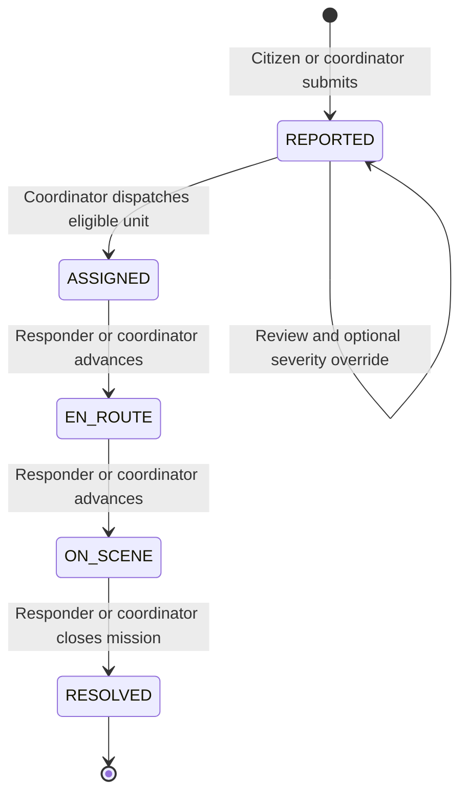
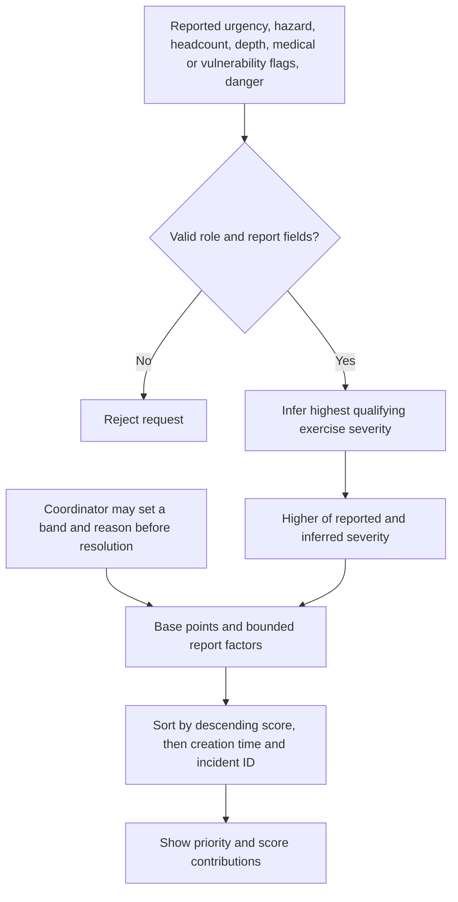
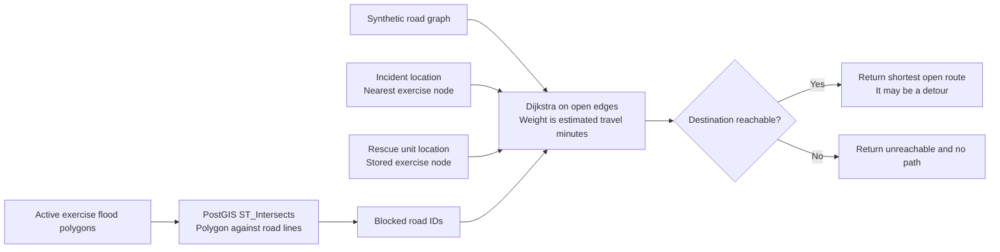
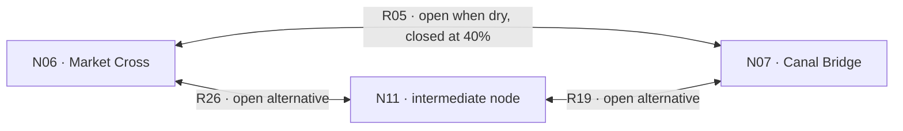
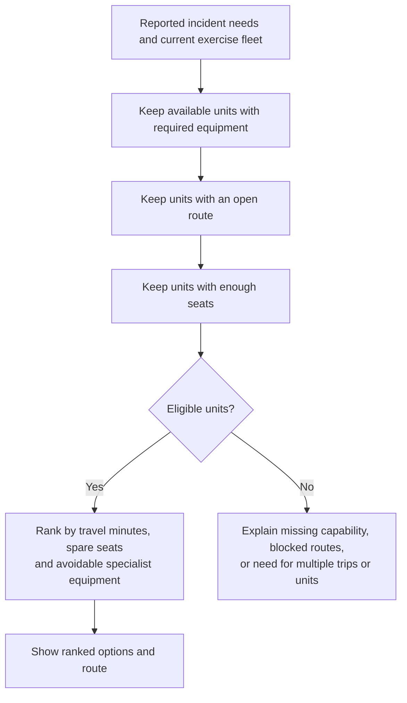
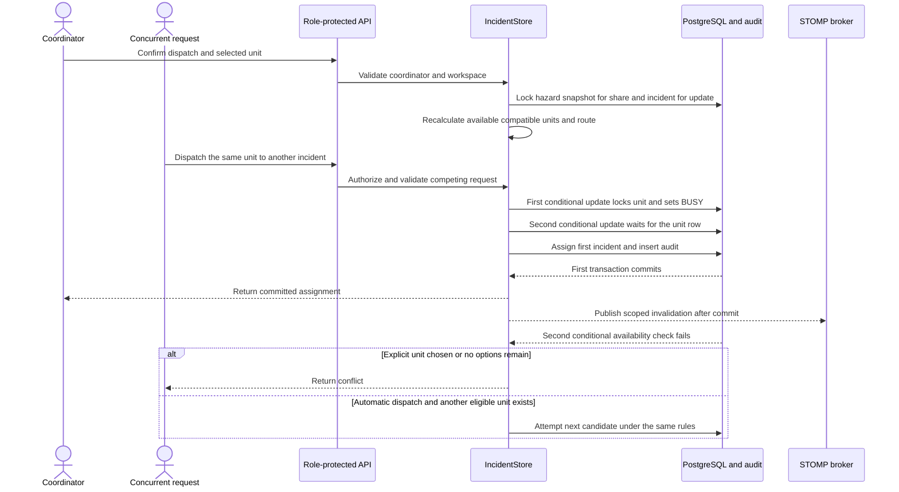
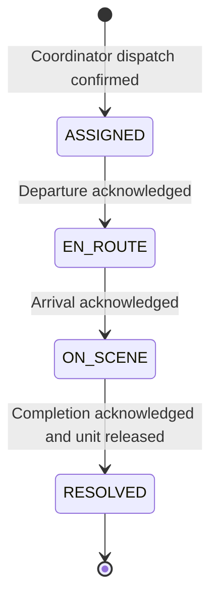
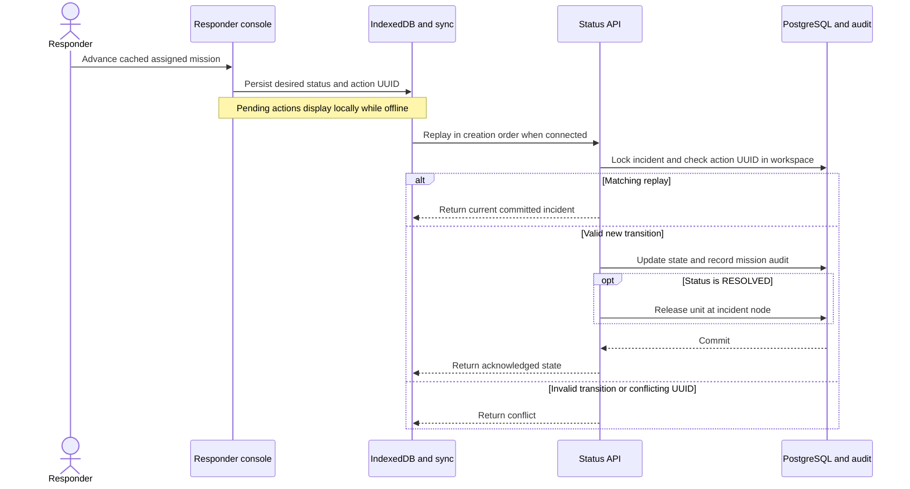

# Triage, routing and rescue response

## Incident lifecycle

Initial triage is calculated for the reported record. A coordinator may override severity before resolution, with a reason recorded in the workspace audit. Severity review changes the priority shown to the coordinator and leaves the incident status unchanged. Unit assignment begins with dispatch. The server permits the ordered progression shown and rejects an invalid transition with a conflict. The five states are the actual persisted statuses. [State enum and request DTOs](../../backend/src/main/java/com/hydrogrid/api/Models.java) · [Role requirements](../../backend/src/main/java/com/hydrogrid/api/OperationsController.java) · [Transaction logic](../../backend/src/main/java/com/hydrogrid/store/IncidentStore.java)

## Triage and prioritization

| Rule | Result |
| --- | --- |
| Immediate danger or depth ≥ 100 cm | Critical inference |
| Medical need or medical hazard, depth ≥ 55 cm, or headcount ≥ 8 | High inference when critical does not apply |
| Vulnerability, depth ≥ 20 cm, or headcount ≥ 4 | Medium inference when higher thresholds do not apply |
| Other reports | Low inference |
| Score | Band ordinal × 100, plus up to 20 for headcount, 25 for medical urgency, 15 for vulnerability, up to 8 for depth, and up to 30 for waiting time while reported |

The person reporting the incident can choose a higher band. Missing reported severity defaults to low before inference. An explicit coordinator override supplies the scoring band directly and records its reason. These rules are deterministic. They use entered exercise details and should be interpreted as practice triage. [Scoring and thresholds](../../backend/src/main/java/com/hydrogrid/engine/HydroEngine.java) · [Ordering and override](../../backend/src/main/java/com/hydrogrid/store/IncidentStore.java) · [Engine tests](../../backend/src/test/java/com/hydrogrid/engine/HydroEngineTest.java)

## Flood-aware routing

In the verified example, the dry route uses R05. Applying 40% exercise flood intensity closes it and the open path detours through N11. Each road is weighted by stored distance and speed. The server excludes all intersecting segments from the route search. Closure geometry and travel speeds are exercise inputs. The sourced Bengaluru street preview has a separate routing graph and receives no exercise or field closures. [Spatial intersection](../../backend/src/main/java/com/hydrogrid/store/SpatialGraph.java) · [Road and detour implementation](../../backend/src/main/java/com/hydrogrid/engine/RoadNetwork.java) · [Route test](../../e2e/tests/api.spec.mjs) · [Sourced street route](live-data.md#public-streets-and-weather)

## Rescue resource matching

Medical incidents require medical equipment. Floods require a boat or high-clearance equipment, and depths of at least 55 cm require a boat. The HydroGrid matcher adds 0.35 per spare seat, 1.25 for using a boat when its specialty is unnecessary, and 0.85 for unnecessary medical equipment. Lower rank wins. Travel time and unit ID resolve ties. Recommendations use a snapshot of current availability and routing. The dispatch transaction rechecks eligibility. Capacity shortfalls receive a suggestion to coordinate multiple units or trips. The app has no automatic multi-unit allocation. [Matcher and tie-breakers](../../backend/src/main/java/com/hydrogrid/engine/HydroEngine.java) · [Recommendation endpoint](../../backend/src/main/java/com/hydrogrid/api/OperationsController.java)

## Transactional dispatch

The incident row lock serializes competing assignments to the same incident. Repeating the matching active assignment can return the existing incident. Conflicting requests fail. For different incidents contending over one rescue unit, the conditional `AVAILABLE → BUSY` update takes a unit-row lock and rechecks eligibility when the earlier write commits. Assignment and its audit commit together. An uncommitted attempt produces no scoped event. [Dispatch code](../../backend/src/main/java/com/hydrogrid/store/IncidentStore.java) · [Concurrent dispatch integration test](../../backend/src/test/java/com/hydrogrid/HydroGridIntegrationTest.java)

## Responder mission lifecycle

The responder browser queues milestones through the same outbox as practice SOS. Pending intent can advance the displayed mission before the API acknowledges it. The workspace-scoped lock on the incident and unique action IDs enforce order and deduplicate replay. A new action that requests the already current status returns the existing incident without another transition audit. A conflicting or out-of-order transition rolls back and is visible as a replay failure. Resolved releases the unit at the incident node. A coordinator and an authorized responder both have API permission to advance the assigned incident. [Responder console](../../frontend/src/pages/Responder.tsx) · [Mission transaction](../../backend/src/main/java/com/hydrogrid/store/IncidentStore.java) · [Offline responder browser test](../../e2e/tests/browser.spec.mjs)
