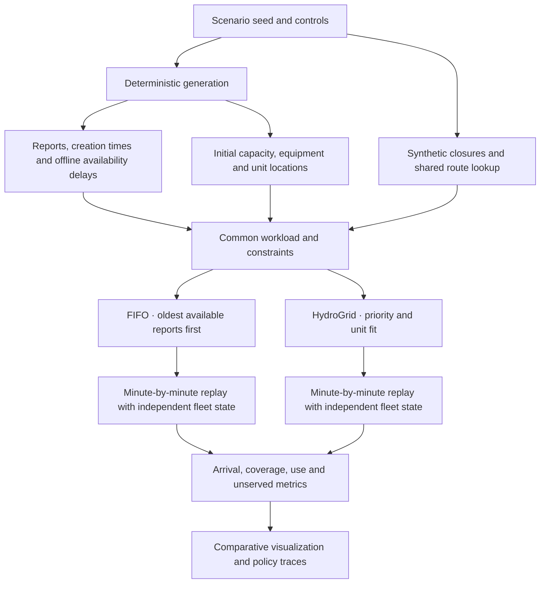

# Simulation engine lifecycle

The Simulation Lab submits a seed and bounded controls for report count, unit count, flood intensity and network disruption. The coordinator-scoped API returns two traces for the same synthetic input. Simulation replay is independent of current shelter occupancy, operational trace data and real emergencies. [Simulation API](../../backend/src/main/java/com/hydrogrid/api/OperationsController.java) · [Simulation Lab](../../frontend/src/pages/Simulation.tsx)

| Decision | Implementation |
| --- | --- |
| Shared inputs | A seeded `SplittableRandom` generates one incident stream and initial fleet. Each replay copies the initial fleet state and uses the same incident availability delays, blocked road IDs, open-route lookup, equipment, seat constraints and service times. |
| FIFO baseline | Order by availability minute, then creation time and ID. For a feasible report, take the fastest compatible unit with an open route and enough seats. |
| HydroGrid policy | Recalculate the priority of waiting reports. Use deterministic triage to order them and choose an eligible unit by time, capacity fit and specialist equipment use. |
| Minute replay | Introduce reports due at a given minute and dispatch available units. Leave a report waiting if no unit fits. The next dispatch depends on the unit's travel and service time and last incident location. |
| Reached and response time | A report is reached if arrival is at or before minute 120. Response time is arrival minus creation, including any offline delay. A report without such an arrival counts as unserved. The mean covers reached reports. |
| Critical coverage and utilization | Count reached critical reports over all generated critical reports. Utilization divides busy unit-minutes within the horizon by the fleet's available unit-minutes. The extended benchmark calculates p95 from the reached-report traces. |

Across the nine paired benchmark runs, HydroGrid reached **135/141 critical reports** and FIFO reached **92/141**. FIFO reached **670/930** overall and HydroGrid reached **659/930**. The pooled median was **24 minutes** for FIFO and **18 minutes** for HydroGrid, while pooled p95 rose from **80** to **86 minutes**. The simulator presents outcomes under controlled inputs. The measured trade-off depends on the tested workloads and on the cutoff used to count arrivals. [Verified results and reproduction](../benchmarks.md) · [Execution engine](../../backend/src/main/java/com/hydrogrid/engine/DispatchSimulation.java) · [Simulation tests](../../backend/src/test/java/com/hydrogrid/engine/DispatchSimulationTest.java)
